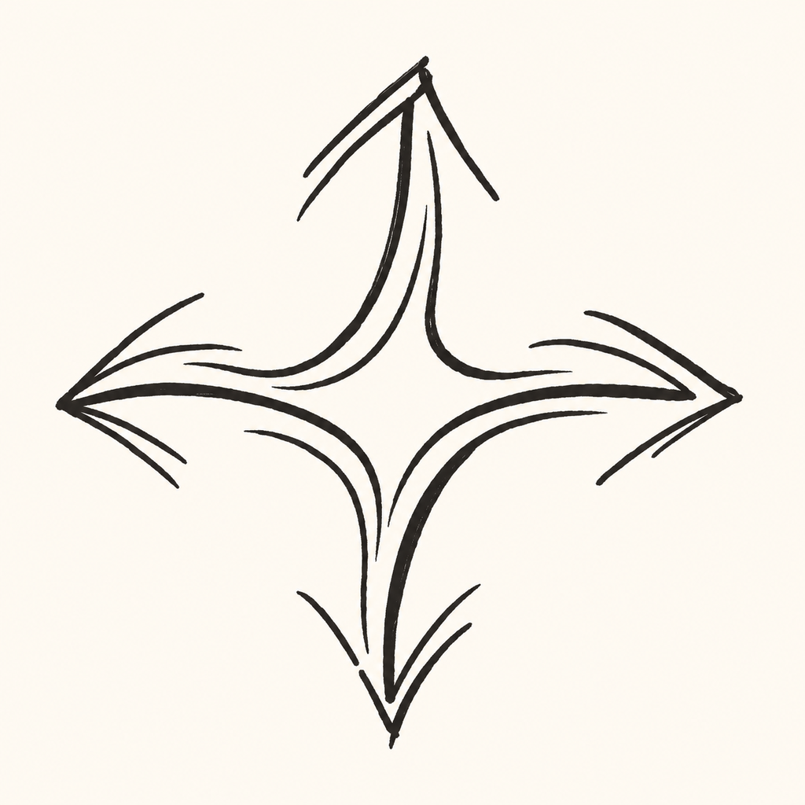
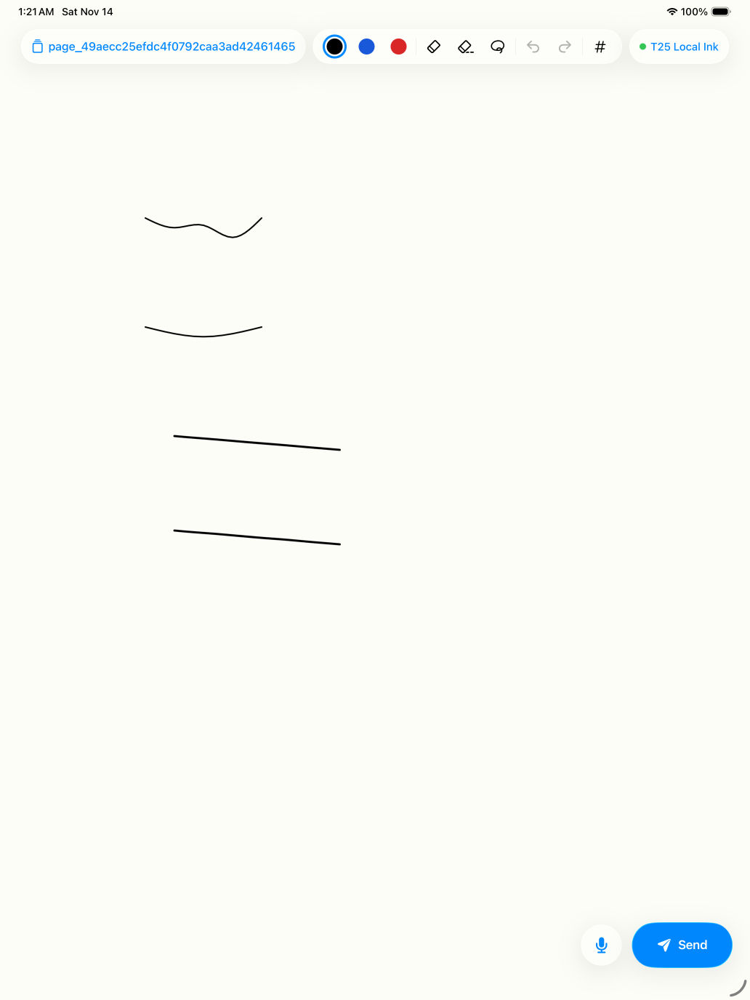

<p align="center">
  
</p>
<h1 align="center">Reflex</h1>
<p align="center"><strong>Draw, write and speak on your iPad. Send it to Claude Code or Codex on your Mac.</strong></p>
<p align="center">
  <a href="https://testflight.apple.com/join/R81n88Re"></a>
</p>
<p align="center">
  <a href="#connect">Quick start</a> · <a href="docs/README.md">Documentation</a> · <a href="CONTRIBUTING.md">Contribute</a> · <a href="LICENSE">MIT license</a>
</p>

Sketch an idea, circle the part you mean, or hold the mic to explain it. Press **Send** and your agent receives the marks, words and board images together. Read its answer in your agent session.

> **iPad beta:** requires iPadOS 26 or later. The TestFlight build was submitted for Apple’s beta review on November 16, 2026; the public link currently says “This beta isn’t accepting any new testers right now.”

<p align="center">
  
</p>
<p align="center"><sub>Earlier iPad Simulator capture from <a href="docs/evidence/t25/verification.md">native canvas and Send verification</a>. Simple test strokes, with no artwork added.</sub></p>

## Connect

You need the [iPad beta](https://testflight.apple.com/join/R81n88Re), a Mac with [Node.js 22 or later](https://nodejs.org/en/download), Git, and a working Claude Code or Codex installation. No Reflex account or server setup is needed.

### Claude Code

Paste this in your Mac’s terminal, in the folder where you use Claude Code:

```sh
claude mcp add reflex -- npx -y "github:JohanSardar/reflex#npx" mcp
```

Start a new `claude` session in that folder so it loads the server. Say **“connect my iPad”** and allow Reflex’s tools if Claude Code asks. Your agent gives you a six-digit code.

### Codex

Add this block to `~/.codex/config.toml` (replace an existing Reflex block rather than adding a duplicate):

```toml
[mcp_servers.reflex]
command = "npx"
args = ["-y", "github:JohanSardar/reflex#npx", "mcp"]
tool_timeout_sec = 300
```

Start a new Codex session and say **“connect my iPad to Reflex”**. Your agent gives you a six-digit code.

### On your iPad

1. Open Reflex, tap **Pair with Mac**, and enter the code from your agent. Allow Local Network access when iPadOS asks.
2. Draw or write on the board, then tap **Send**. You can also hold the mic to speak; releasing it sends your words.
3. Read the answer in Claude Code or Codex. Your agent waits for the next Send through `wait_for_user`.

Pairing tries the same Wi-Fi and nearby connections first, then the relay if needed. The code also approves the agent that gave it to you. It works once, expires after ten minutes, and closes after five failed attempts. Keep it private.

If the agent doesn’t see Reflex, or pairing stalls, see [troubleshooting](docs/troubleshooting.md).

## How it works

**iPad → Mac Link → your agent.** The iPad keeps your board locally. A Send packages your new marks, their context, spoken words and board images. The Mac Link stores it and delivers it to approved agents through MCP. The agent answers in its own session; it cannot draw on your canvas.

Drawing stays local until you Send. Speech recognition runs on the iPad. Paired device traffic is encrypted end to end, including when it passes through the relay. The relay can see connection addresses, timing and traffic volume, but cannot read your content. The agent and its AI provider receive what you send and apply their own data policies. This is a beta, not an independently audited security product.

Read [privacy and security](docs/privacy.md) for the trust boundaries, [the relay guide](docs/relay.md) to self-host or turn the relay off, and [SECURITY.md](SECURITY.md) to report a vulnerability privately.

## Inside the repo

| Part | What it does |
| --- | --- |
| [apps/ipad/](apps/ipad/) | Native iPad app: PencilKit canvas, voice and Send |
| [agent/](agent/) | MCP server and CLI for Claude Code, Codex and other receivers |
| [link/](link/) | Mac background service: pairing, approvals and durable Send delivery |
| [relay/](relay/) | Forwards encrypted connections when devices are apart |
| [dist/](dist/) | Small prebuilt CLI bundle used by the `npx` install |
| [docs/](docs/) | User guides, architecture, specification and research |

The [npx workflow](.github/workflows/npx-branch.yml) copies changed builds and the nearby Wi-Fi helper to a small `npx` branch. Installing Reflex doesn’t download the iPad source or build the app.

## Go deeper

- [Documentation](docs/README.md): troubleshooting, privacy, relay and developer references.
- [Contributing](CONTRIBUTING.md): build locally and show a change working.
- [Project standards research](docs/research/github-front-pages.md): Happy, Immich and LocalSend compared with Reflex.
- [Report a bug](https://github.com/JohanSardar/reflex/issues/new/choose) or [report a security issue privately](https://github.com/JohanSardar/reflex/security/advisories/new).

Reflex is open source under the [MIT license](LICENSE).
