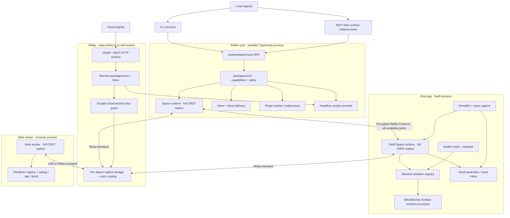
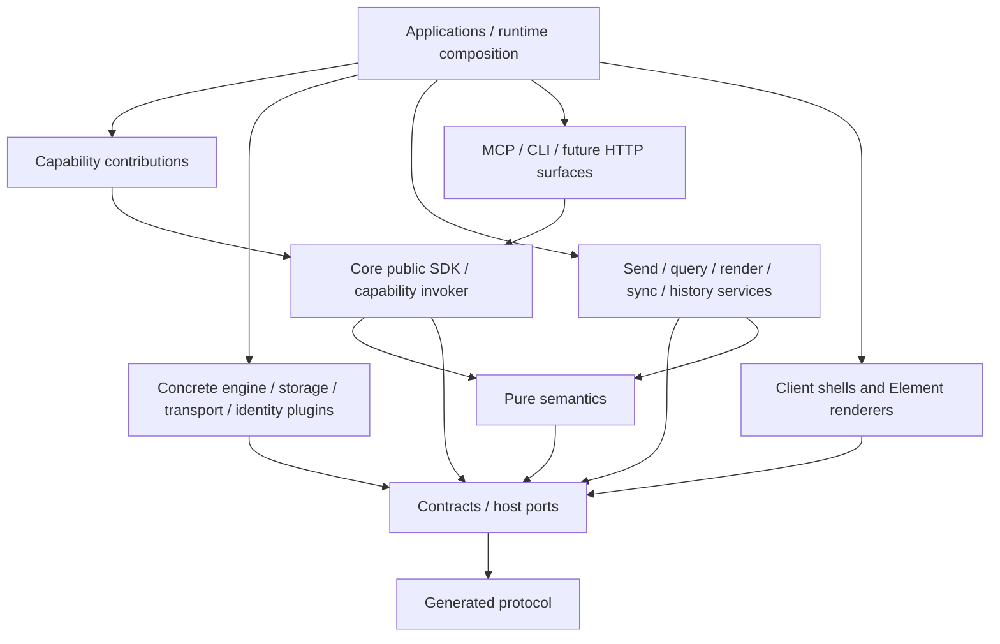

# Reflex architecture

Design proposal · 2026-11-10 · research checked against primary sources on this date.

This document implements [SPEC.md](../SPEC.md), the canonical [GLOSSARY.md](../../GLOSSARY.md), and [ADR-0001](../adr/0001-crdt-scene-document.md), [ADR-0002](../adr/0002-wait-for-user-before-push.md), and [ADR-0003](../adr/0003-one-capability-model-cli-follows-vercel-guidelines.md). Signature sketches describe proposed Reflex APIs, not existing application code or verbatim library APIs. Numbers marked as targets are proposed acceptance thresholds, not measured results. Conflicts with settled decisions are collected in §11.

## 1. Overview: a small kernel and replaceable implementations

Use ports and adapters, a manifest-driven contribution registry, and separate composition roots for each runtime. Keep ownership, authorization, transaction semantics, Send durability, and compatibility in the kernel. Put every growing collection behind a contribution contract. Built-in Element types use exactly the contracts available to contributors.

The precedent is Cockburn's separation of application semantics from technology-specific adapters. VS Code adds declarative contributions, lazy activation, runtime placement, and disposal. Reflex adopts those boundaries without treating every extension process as a security sandbox. [Ports and adapters](https://alistair.cockburn.us/hexagonal-architecture/), [VS Code contributions](https://code.visualstudio.com/api/references/contribution-points), [extension runtimes](https://code.visualstudio.com/api/advanced-topics/extension-host).



Arrows inside a process show calls or data flow, not permitted source imports. §6 defines source dependencies. The Relay's ability to store an encrypted replica versus materialize a CRDT is an explicit tension in §11.1; this diagram does not give the Relay an always-present decryption key.

### 1.1 Runtime decisions

- **iPad:** Swift modules, PencilKit for Ink, SwiftUI for Panels, WKWebView for HTML Embeds, RealityKit for 3D Embeds. One actor serializes each open Space's transactions; rendering stays on the main actor. Platform frameworks never enter protocol or semantic modules.
- **Reflex Link:** `npx reflex link` starts one long-lived process per user profile. It owns replicas, local RPC, durable Inbox state, sync, plugin execution, and render services. Each MCP stdio connection is a small subprocess forwarding to that process. A CLI invocation uses the same RPC. A closed stdio pipe must not kill Reflex Link or lose a Send.
- **Relay:** Cloudflare Worker ingress, a SQLite-backed Durable Object per Space for routing and persistence, and a short-lived authorized plaintext execution context for a cloud Agent. A Node deployment implements the same service ports with SQLite and WebSockets. Neither implementation arbitrates CRDT truth.
- **Web viewer:** TypeScript runtime in a worker, renderer on the UI thread, browser persistence adapter. It participates in replication; it is not just a remote screenshot viewer. Pencil capture remains an iPad feature.
- **Rendering without an iPad:** Reflex Link supplies headless native-core rendering. The Relay uses the same portable render provider or a separately deployed render service. Workers cannot be assumed to contain Chromium. Exact live HTML captures need a compatible live renderer; results distinguish a fresh capture, a revision-tagged cache, and a fallback preview.

### 1.2 The durable model and the local model

One Space is one CRDT document, preserving ADR-0001. Do not split it into independent Element CRDT documents to conceal memory problems. Separate immutable large assets from the CRDT; its complete manifest and references remain replicated. Full CRDT replication does not imply keeping every decoded image, 3D mesh, or PencilKit cache in RAM.

```ts
type ElementRecord = {
  id: ElementId; incarnation: string; type: TypeId; typeVersion: number;
  owner: { kind: "user" } | { kind: "agent"; agentId: AgentId };
  transform: Transform2D; bounds: Rect; order: OrderKey;
  props: JsonObject; behaviorIds: BehaviorId[]; assetRefs: AssetRef[];
};
type SpaceState = {
  metadata: SpaceMetadata;
  elements: Record<ElementId, ElementRecord>;
  removedIncarnations: Record<string, RemovalRecord>;
  panels: Record<PanelId, PanelDefinition>;
  behaviors: Record<BehaviorId, BehaviorDefinition>;
  regions: Record<RegionId, RegionDefinition>;
  batches: Record<BatchId, BatchRecord>;
  sends: Record<SendId, ImmutableSendRecord>;
  receipts: Record<ReceiptId, ImmutableReceipt>;
  assetManifest: Record<AssetId, AssetManifestEntry>;
};
```

These are logical types. The engine maps them to nested CRDT maps, sequences, text, and scalar registers. `props` has a plugin-declared merge layout: scalar fields, nested maps, keyed collections, or collaborative text. Never serialize the entire Element or entire Space into a single last-writer-wins JSON value. Initial container creation has a shared genesis; peers must not independently create conflicting root maps.

Deleting an incarnation adds an immutable removal record; concurrent patches cannot resurrect it. Restoring it creates a new incarnation under a controlled restore operation. Competing scalar edits use the selected engine profile's deterministic resolution; expose material conflicts when relevant. IDs and owners are immutable. `owner` is assigned from the authenticated context, never trusted from Agent arguments. The user layer and each Agent layer are derived from ownership rather than duplicated layer fields.

Keep viewport, current Space, active pen, selection, in-progress strokes, caches, spatial indexes, and undo cursor **local**. Replicate presence through an ephemeral channel with expiry. Agent `focus` changes only that Agent's view used by `look`; it cannot navigate the user's UI. `request_attention` produces a banner. Region rules are semantic policy, with deterministic overlap resolution: explicit priority, then specificity, then Region ID; any applicable Agent-read-only rule denies the write. Behavior execution produces validated intents, never arbitrary callbacks from Agent-authored data.

Completed Ink uses immutable per-stroke geometry assets plus small CRDT records for identity, transform, visible mask, and lineage. Precise erasure records new mask geometry or replacement fragments and their parent stroke; it does not overwrite a whole `PKDrawing` blob. Preserve an optional PencilKit archive for fidelity and a versioned portable stroke representation for web rendering and export. Assets use immutable content addressing within the encrypted Space, chunking, integrity checks, and reference manifests. Persist assets before committing a durable reference. Retain assets referenced by history or an unacknowledged Send; garbage collection needs a documented retention/checkpoint policy.

The Inbox is a materialized view of replicated immutable Send records and receipts, with a durable local index. Indexes can be rebuilt; they are not a second source of truth. A Send record pins its CRDT frontier, its included user edits, recipients, and asset manifest. Subsequent rendering or recognition cannot silently mutate an already delivered Send Bundle.

## 2. Module catalog

`P` below means generated protocol types; `K` means the small plugin contracts package. Public interfaces below are deliberately narrower than their implementations. A module can call another module's port without importing its concrete adapter. Unless named, dependencies on applications, concrete plugins, and platform SDKs are forbidden. Swift equivalents use the same generated types and conformance fixtures rather than embedding the TypeScript core in WKWebView.

| Module / responsibility | Public interface sketch | Allowed dependencies | What may never depend on it |
| --- | --- | --- | --- |
| `protocol`: wire models, schemas, errors, canonical encodings | `decodeEnvelope(bytes): Result<Envelope>`; Swift `Envelope: Codable, Sendable` | Schema-generated code only | Nothing is below it; it must not import any Reflex runtime |
| `contracts`: extension points and host ports | `Registry<T>.resolve(id, version): T`; Swift `ContributionRegistry<T>` | P | Protocol must never import it |
| `semantics`: ownership, operation validation, coordinate conversion, Region rules | `prepare(view, intent, ctx): PreparedBatch`; Swift `prepare(_:in:as:) throws` | P, K, pure geometry | P/K; platform implementations must not become semantic inputs |
| `core`: one Agent capability model and orchestration | `Core.invoke(capabilityId, input, ctx): Promise<CapabilityResult>` | P, K, semantics; injected port interfaces | P/K, semantic module, CRDT/transport/storage implementations |
| `capabilities`: registered built-in capabilities | `Capability<I,O> { descriptor; execute(i,ctx): Promise<O> }` | Core public SDK, P, K | Core dispatcher, protocols, plugin contracts |
| `space-runtime`: serial transactions, persistence barriers, revision views | `SpaceRuntime.transact(prepared): Promise<CommitReceipt>`; Swift actor equivalent | P, K, semantics, engine/storage ports | Core must depend on its port, never its concrete runtime |
| `engine-*`: CRDT implementation and projection mapping | `ReplicaEngine.commit`, `receive`, `sync`, `viewAt` (§3.9) | P, K, chosen CRDT library | Core, semantics, Elements, formats, surfaces; no library document handles leak |
| `storage-*`: local journal, checkpoints, asset storage, crash recovery | `Journal.appendAtomic(record): Promise<void>`; `BlobStore.put(hash, bytes)` | P, K, SQLite/filesystem/OPFS/Cloudflare SDK as appropriate | Core, semantics, engine contract, plugin logic |
| `sync`: multiplex peers, reconnect, anti-entropy, latency-aware scheduling | `Sync.attach(path: Path): Disposable`; `publish(change: DurableChange)` | P, K, injected engine/crypto/transport ports | Engine, storage, Element definitions, capabilities |
| `transport-*`: discover or open byte paths | `Transport.open(peer, signal): Promise<Path>` (§3.3) | P/K, networking SDK | Core, sync contracts, engine, other transports |
| `identity-*`: authenticate, pair, identify Agents, resolve grants | `IdentityProvider.authenticate(evidence): Promise<Principal>` | P/K, selected OAuth/device credential libraries | Semantics and authorization policy; providers cannot define write rights |
| `crypto-*`: encryption, signatures, Space key epochs and grants | `Crypto.seal(header, bytes, keyRef): Promise<EncryptedFrame>` | P/K, audited cryptography implementation | Core semantic types, engine, transport; no crypto implementation imports UI |
| `history`: author-scoped undo, Agent batch revert, timeline | `History.planRevert(batchId, view, principal): RevertPlan` | P/K, semantics, revision-view port | Engine and protocol; plugins cannot replace ownership checks |
| `scene-query`: full/outline/cluster projection and spatial lookup | `SceneQuery.read(view, query, budget): SceneResult` | P/K, pure geometry, Element model ports | Element contracts, engine, renderers |
| `render`: revision-bound `look`, crops, thumbnails, fallback previews | `RenderProvider.render(RenderRequest): Promise<RenderResult>` | P/K, Element render ports, asset port | Core and Send assembly cannot import UIKit/DOM/Chromium |
| `elements/*`: one type's semantics, metadata, lints and render contributions | `ElementType<P>` + `IPadElementRenderer<P>` + `WebElementRenderer<P>` (§3.2) | P/K, pure geometry and declared renderer SDK | Kernel, other Element types, formats' base contracts |
| `input`: completed Ink edits, touch intents, voice transcript capture | Swift `InputSource.events() -> AsyncStream<UserIntent>` | P/K, PencilKit/Speech behind capture adapters | Core, protocol, engine, recognizer contracts |
| `recognition`: grouping, bounded recognizer execution, ranked mark candidates | `Recognition.analyze(input, plugins): Promise<MarkAnalysis>` | P/K, recognizer ports, spatial-query port | Capture adapter and recognizer plugins must not import its implementation |
| `anchoring`: resolve marks against Element and Embed coordinates | `Anchors.resolve(mark, view): Promise<AnchorCandidate[]>` | P/K, geometry, Element anchor-provider ports | Element contracts, raw Ink, engine |
| `send-assembly`: freeze turn, compute user changes, render and assemble | `SendAssembler.create(trigger, frontier): Promise<SendId>` | P/K, query/render/recognition/anchor/transcript ports | Renderers, recognizers, Input sources, engine |
| `inbox`: durable per-recipient pending state and acknowledgements | `Inbox.pending(agent, filter)`; `ack(receipt)`; `wait(deadline, signal)` | P/K, persistence/replication port | Send Adapters, MCP/CLI; Inbox never imports a harness SDK |
| `delivery`: adapter selection, attempts, retries and backpressure | `Delivery.offer(sendId, recipient): Promise<void>` | P/K, Inbox port, Send Adapter registry | Inbox, core semantics, concrete Send Adapters |
| `send-adapters/*`: wait, channel, webhook/SDK, MCP App delivery | `SendAdapter.offer(DeliveryAttempt): Promise<DeliveryOutcome>` | P/K, delivery-scoped host ports, optional harness SDK | Inbox, delivery implementation, core |
| `formats/*`: import and export conversions | `Format.import(source, ctx): ImportPlan`; `export(view, options)` | P/K, asset and render ports, format library | Core, Elements, protocol; converters cannot bypass `apply` |
| `recipes/*` and `docs`: patterns, examples, on-demand Agent guides | `Recipe.expand(input, ctx): Promise<RecipePlan>`; `Docs.read(topic, budget)` | P/K, declarative Element/Behavior/Region schemas | Kernel and Element types; no product domain enters the kernel |
| `panels-behaviors`: safe component catalog and interaction rules | `PanelCatalog.resolve(kind)`; `BehaviorInterpreter.evaluate(event): UserIntent[]` | P/K, semantic policy, client renderer port | Protocol, engine, core; no dependency on A2UI's current wire format |
| `embed-runtime`: HTML isolation and small bridge; 3D picking | `EmbedPort.call(method, ownElementScope)`; `AnchorProvider` | P/K, platform web/3D APIs | Core, protocol, other Element types; never exposes a Space handle |
| `exec-runtime`: bounded JavaScript escape hatch | `Exec.run(source, SimplifiedSpaceAPI, limits): Promise<ApplyPlan>` | P/K, sandbox adapter, read-only query/capability port | Core imports only its port; sandbox cannot import filesystem or identity providers |
| `surfaces/*`: MCP, CLI, future HTTP/SDK bindings | `Surface.start(CapabilityInvoker, Catalog, Lifecycle)` (§3.8) | P/K, core public invoker, binding SDK | Core, semantics, capabilities, and all sibling surfaces |
| `runtime-*` and application shells: composition and lifecycle | `compose(config, contributions): Runtime`; Swift `ReflexAppComposition` | All needed public entry points | Every reusable module; no library imports an app |
| `conformance`: reusable fixtures, adversarial traces, plugin certification | `runPluginSuite(kind, factory, fixtures): Report` | Public contracts and test adapters | Production packages; tests never become runtime dependencies |

`send-assembly`, `history`, `scene-query`, and `panels-behaviors` are separate packages once implemented, not private folders inside a giant `core`. Their ports live in K. Only `runtime-*` selects implementations. System clock, random IDs, scheduling, tracing, and cancellation are narrow injected utility ports, not a general-purpose service locator.

## 3. Plugin contracts

### 3.1 Registration, execution and trust

```ts
type PluginManifest = {
  id: string; version: string; api: string; protocol: string;
  runtimes: ("link" | "relay" | "web" | "ipad")[];
  contributes: {
    elements?: ElementContribution[]; transports?: EntryPoint[];
    sendAdapters?: EntryPoint[]; recognizers?: EntryPoint[];
    formats?: EntryPoint[]; recipes?: EntryPoint[];
    surfaces?: EntryPoint[]; capabilities?: CapabilityDescriptor[];
    panelComponents?: EntryPoint[]; behaviors?: EntryPoint[];
    engines?: EntryPoint[]; storage?: EntryPoint[]; identity?: EntryPoint[];
  };
  permissions: PermissionRequest[];
  dependencies: { id: string; range: string }[];
  artifacts: { path: string; sha256: string; runtime: string }[];
};
interface PluginLifecycle {
  activate(host: ScopedHost, signal: AbortSignal): Promise<Disposable>;
}
```

IDs are namespaced, for example `org.example.scatter-plot`, not mutable display names. Type IDs are stable across package releases. Parse manifests and schemas before executing entry points. Reject duplicate registrations, incompatible API ranges, missing artifacts, dependency cycles, conflicting capability names, and ungranted permissions. Sort discovery deterministically so tools, CLI help, and Agent docs stay stable. Activate on first use; disposal releases subscriptions, paths, and render resources. Disable or remove a plugin without deleting its Elements or queued Sends.

Separate three execution classes:

1. **First-party or explicitly installed native modules:** compiled SwiftPM targets and reviewed TypeScript packages at composition time. They are trusted application code, despite narrow interfaces.
2. **Installed third-party execution:** a separate Node process for privileged Reflex Link plugins; workers for pure computation and browser rendering. Use explicit RPC grants and OS restrictions where available. A Node worker alone is not a security boundary. The Relay allows only operator-installed code, never code uploaded by an Agent.
3. **Agent-authored content:** HTML, declarative Panels, recipes, text, and `exec` programs receive restricted content APIs. They do not become installed plugins and cannot register a new native entry point.

The iPad cannot download arbitrary Swift renderer code into the distributed app. Native contributions are linked in a custom build or a subsequent app release. Data-only contributions can use a supported declarative renderer; HTML stays an Embed. This is a deployment boundary, not a core-code change. Apple's app rules restrict downloaded executable functionality. [App Store guidelines, §2.5.2](https://developer.apple.com/app-store/review/guidelines/).

### 3.2 Element type: all facets travel together

Take tldraw's co-location of type properties, migrations, geometry, rendering, and interaction hooks, but split its editor-bound utility into a portable model contribution and client render contributions. Avoid a central union of every installed Element type. [tldraw ShapeUtil](https://tldraw.dev/reference/editor/ShapeUtil).

```ts
interface ElementType<Props extends JsonObject> {
  id: TypeId;
  schemaVersion: number;
  schema: SchemaRef;
  mergeLayout: MergeLayout;
  defaults(): Props;
  validate(props: JsonValue): ValidationResult<Props>;
  geometry(element: Element<Props>, ctx: GeometryContext): Geometry;
  describe(element: Element<Props>, detail: DetailLevel): SceneFragment;
  lint(element: Element<Props>, ctx: ReadonlyLintContext): Diagnostic[];
  anchors: AnchorProvider<Props>;
  migrations: ReadonlyArray<PureMigration>;
  docs: { summary: string; topics: DocResource[]; examples: Example[] };
  formats: FormatContributionRef[];
  renderers: {
    ipad: RendererRef; web: RendererRef; headless: RendererRef;
  };
}
interface WebElementRenderer<Props> {
  mount(element: Element<Props>, host: ElementRenderHost): RenderHandle;
  // RenderHandle supports update, dispose, accessibility and hit testing.
}
interface HeadlessElementRenderer<Props> {
  render(element: Element<Props>, ctx: ExportContext): Promise<RenderFragment>;
}
interface AnchorProvider<Props> {
  project(mark: LocalMark, element: Element<Props>,
          ctx: AnchorContext): Promise<AnchorCandidate[]>;
  reproject(anchor: Anchor, from: RevisionView,
            to: RevisionView): AnchorResolution;
}
```

```swift
public protocol IPadElementRenderer {
    associatedtype Properties: Codable & Sendable
    @MainActor func makeContent(
        element: Element<Properties>, host: ElementRenderHost
    ) -> ElementContent
    @MainActor func update(_ content: ElementContent,
                           element: Element<Properties>)
    func geometry(_ element: Element<Properties>) -> ElementGeometry
}
public protocol ElementAnchorProvider: Sendable {
    func project(_ mark: LocalMark, in element: AnyElement,
                 context: AnchorContext) async throws -> [AnchorCandidate]
}
```

`ElementContent` is a renderer-SDK wrapper supporting SwiftUI, UIView-backed content, accessibility and disposal; type erasure happens in that SDK. These platform types are absent from K's wire contracts. The generic rendering host exposes only the Element, its permitted asset handles, theme, viewport transforms, and a way to submit intents. It never exposes the CRDT.

Every type must provide a web renderer and an iPad renderer contribution. Either can explicitly use a shared declarative display-list renderer; a contributor need not write native code for a simple type. A renderer requiring native custom interaction supplies Swift code. Headless output may share the web renderer or generate a display list. The packaging validator also requires schema, merge layout, Agent documentation, lint entry point, anchor provider, migrations, import/export declarations, and conformance fixtures. An empty lint list or a generic local-coordinate anchor is valid only when explicitly declared and tested.

**Unknown types:** preserve their envelope, props, assets, and version without decoding props into a closed enum. Show bounds, owner, accessible summary, and an available preview. Allow user move/delete through envelope operations, but no props editing by an incompatible plugin. Agents receive an `unsupported_type_version` diagnostic for incompatible props writes. A preview is never substituted for authoritative structured data.

**Anchors:** store `elementId`, incarnation, type ID/version, target revision, original Space geometry, and a typed target: `local2d`, `textRange`, `data`, `dom`, or `surface3d`, plus namespaced extensions. Include confidence, alternatives, and resolution status. The base inverse transform maps Space coordinates to local coordinates. Type providers refine that mapping:

- Text: stable text ranges and quote/context fallback, not offsets without a revision.
- Charts: stable datum/series IDs plus scale version and inverse mapping; logarithmic axes and zoom are explicit.
- HTML: stable content-supplied identifiers or a DOM path, local rectangle, content revision and layout transform. Arbitrary HTML may only support a local-coordinate fallback.
- 3D: stable part/primitive ID, model asset hash, local point or barycentric coordinates and captured camera pose. A screen-space circle alone is ambiguous after rotation.

Capture a target and transform at marking time, and freeze their interpretation at Send time. Never retarget silently to a replacement Element after deletion. Mark interpretation is derived metadata; reprojecting it does not authorize an Agent to move or rewrite the user's raw Ink.

**Third-party example, end to end:** add `org.example.scatter-plot`:

1. Create an external extension package containing `reflex.plugin.json`, `schema/props.schema.json`, `schema/anchor.schema.json`, merge layout, migrations, docs, and fixture data. Props reference an immutable dataset asset with stable row IDs; axes specify scale and units.
2. Generate `ScatterPlotProps` and `ScatterPlotAnchor` in Swift and TypeScript with the same toolchain as core schemas. A pure model contribution supplies geometry, accessible text, full/outline scene descriptions, and lints for missing data and invalid scales.
3. Supply `web/ScatterPlotRenderer` and `swift/ScatterPlotRenderer`. They render the same normalized plot layout and implement inverse axis transforms. A display-list headless contribution supports `look`, PNG and PDF while the iPad sleeps.
4. Supply the anchor provider. A lasso returns both the polygon in data coordinates and stable selected row IDs, with the dataset hash and scale revision. A mark over a legend returns a series target. Changing a dataset cannot make row index 12 accidentally refer to a different datum.
5. Register CSV/JSON import contributions and portable-data export contributions, plus the generic PNG/PDF render export path. Import produces ordinary `add` operations through `apply`; it does not insert raw CRDT values.
6. Package docs under the type ID. Registry discovery adds the summary to server instructions and exposes detailed instructions through `read_me`; recipes can refer to the type without the core knowing chart terminology.
7. Run the Element, Format, renderer, schema, anchor, and migration contract suites. Include lasso selection after resize, log-axis inversion, missing renderer fallback, and read/write preservation on an older client.
8. Install the TypeScript artifacts in Reflex Link and the web composition; link the SwiftPM product in the iPad distribution. Generated registration discovers its manifest. No `switch(type)` edits in core, renderer shell, `apply`, MCP tool definitions, CLI, or Send assembly are needed. App dependency/lockfile and distribution configuration changes are expected.

### 3.3 Transport: bytes, discovery and path measurements

```ts
interface Transport {
  id: string;
  discover(ctx: DiscoveryContext): AsyncIterable<PeerCandidate>;
  open(peer: PeerCandidate, signal: AbortSignal): Promise<Path>;
}
interface Path {
  id: PathId; peer: DeviceId;
  limits: { maxFrameBytes: number; reliable: boolean; ordered: boolean };
  incoming: AsyncIterable<Uint8Array>;
  send(frame: Uint8Array, priority: "control" | "change" | "asset"): Promise<void>;
  measurements(): PathMeasurements;
  close(reason: string): Promise<void>;
}
```

Swift implements the equivalent `Transport` protocol using `AsyncThrowingStream<Data, Error>` and `async` send/open methods. A path reports connectivity, RTT, throughput, queue depth, and errors. It knows no Elements, Inbox, CRDT merge decisions, or Agent permissions. Discovery candidates are untrusted until the paired device proves its key.

The sync coordinator estimates completion time, approximately `RTT + queuedBytes / throughput + frameBytes / throughput`, and selects a live path per change. It can hedge a stalled transfer on another path; duplicate change IDs are harmless. Engine-specific sync conversations are per peer, above the paths, so messages are not accidentally fed to three independent incompatible sync states. Anti-entropy repairs dropped messages and runs after reconnect, regardless of transport reliability. Bound queues and chunk assets; never block fresh control traffic behind a 3D asset. Keep all available paths usable as specified, while respecting platform suspension and retry backoff.

Implement Bonjour/LAN TCP first, macOS/iPad peer-to-peer Wi-Fi through a small Swift Network.framework helper, Relay WebSocket, and a separately probed USB-C path. `NWParameters.includePeerToPeer` enables Apple's peer-to-peer interfaces; Bonjour is discovery, not authentication. Apple documents that its peer-to-peer Wi-Fi protocol works between Apple devices, so a pure Node implementation cannot promise the same path on Windows/Linux. Use normal LAN or Relay there; evaluate Wi-Fi Aware separately. Declare local network usage and Bonjour service types. [Apple networking guidance](https://developer.apple.com/documentation/technotes/tn3151-choosing-the-right-networking-api).

USB-C is a transport slot, not a promise that iPadOS provides a generic socket over any cable. A supported IP-over-USB or companion tunnel implementation must pass the same path tests. Its availability is a §11 open question.

### 3.4 Send Adapter: durability belongs to the Inbox

```ts
interface SendAdapter {
  id: string;
  availability(ctx: RecipientContext): Promise<Availability>;
  offer(attempt: {
    deliveryId: DeliveryId; sendId: SendId; recipient: AgentId;
    bundle: SendBundleView; acknowledgement: AckToken;
    deadline: number; signal: AbortSignal;
  }): Promise<DeliveryOutcome>;
}
type DeliveryOutcome =
  | { status: "acknowledged"; receipt: RecipientReceipt }
  | { status: "offered"; retryAfterMs: number }
  | { status: "unavailable" | "retryable"; reason: string }
  | { status: "rejected"; reason: string };
```

The adapter sees only one recipient's authorized Send Bundle view and scoped acknowledgement token. It cannot remove Ink, clear another Agent's Inbox, or change recipient routing. Disabling an adapter leaves pending Sends intact. `deliveryId` is stable across retries of a recipient/Send pair. Exactly-once execution across partitions or crashes is not promised: delivery is durable and at least once, with recipient-side deduplication by `sendId`.

Build `wait_for_user` and `inbox` before push. A bounded waiter subscribes to the Inbox and races its deadline and cancellation. A timed-out or cancelled waiter acknowledges nothing. Returning a bundle is not proof the harness received it. Return an acknowledgement token and replay the bundle until the next call acknowledges it, or `inbox` explicitly acknowledges it. The CLI has `reflex inbox ack`; MCP's `inbox` capability has the same action. The shared optional call context accepts acknowledgements to avoid an extra round trip. Two offline replicas may both deliver the same Send; deterministic IDs and monotone receipt merging prevent loss, not duplicate delivery.

Freeze recipients when Send is created. Resolve involved Element ownership and Region ownership metadata, use a unique approved Agent owner when unambiguous, otherwise include all approved Agents attached to that Space. One Agent's receipt cannot clear another recipient's pending entry. Read filters never discard nonmatching Sends. Ordering is deterministic after convergence using causal order then stable Send ID, not an assumed global wall clock.

Adapters after the guaranteed path:

- **Claude Code channel:** emit `notifications/claude/channel` with the declared `claude/channel` experimental capability. Prefer a notification containing Send ID, bounded summary and a capability reference; fetch/ack through the ordinary core. Current documentation still calls channels a research preview and restricts custom-channel deployment; isolate its legacy SDK/runtime needs from modern MCP. Channel availability never determines whether Reflex works. [Channels reference](https://code.claude.com/docs/en/channels-reference).
- **Webhook/SDK:** sign a delivery envelope; retry transient failures with backoff. Distinguish transport acceptance from durable consumer acknowledgement. SDK consumers ack after durable receipt; webhook contracts define this explicitly, with an idempotency key and delivery lookup.
- **MCP App:** a live Reflex view uses `ui/message` for user-initiated Sends when the host supports it. A host accepting that method does not prove an Agent consumed the Send. A closed or suspended view cannot serve as a guaranteed push connection; leave the Inbox available. [MCP Apps overview](https://apps.extensions.modelcontextprotocol.io/api/documents/overview.html).

### 3.5 Recognizer: proposals with provenance

```ts
interface Recognizer {
  id: string; version: string;
  kinds: MarkKind[];
  analyze(input: {
    strokes: readonly PortableStroke[]; neighborhood: SceneNeighborhood;
    locale: string; revision: Revision; budget: RecognitionBudget;
  }, signal: AbortSignal): Promise<RecognitionProposal[]>;
}
type RecognitionProposal = {
  strokeIds: StrokeId[]; kind: MarkKind; confidence: number;
  geometry: JsonObject; textHint?: { text: string; confidence?: number };
  provenance: { recognizerId: string; version: string };
};
```

Grouping and candidate arbitration belong to `recognition`, not each recognizer. Geometric heuristics implement circles, strikethroughs, arrows, and proximity first. Handwriting recognition is an independent proposal source; native on-device models can replace or augment it. Keep text confidence separate from gesture and anchoring confidence. If an Apple API does not expose calibrated confidence, label it unavailable or as a separately computed heuristic, not a fabricated model probability.

Recognizers are read-only, bounded, cancellable, deterministic where possible, and cannot send or erase anything. A timeout yields raw strokes and unresolved marks. Record the version and chosen proposal in the Send Bundle, retaining alternatives when ambiguous. Never let a future recognition model reinterpret old delivered Sends invisibly.

### 3.6 Format: conversion plans, explicit loss

```ts
interface Format {
  id: string; mediaTypes: string[]; extensions: string[];
  probe(header: Uint8Array): Promise<number>;
  import?(source: ReadableBytes, ctx: ImportContext): Promise<ImportPlan>;
  export?(view: ExportView, options: JsonObject,
          ctx: ExportContext): AsyncIterable<Uint8Array>;
}
type ImportPlan = {
  assets: StagedAsset[]; batch: ApplyBatch;
  losses: ConversionLoss[]; requiredContributions: ContributionId[];
};
```

Hosts choose among probes using declared priority and user choice; no arbitrary registration-order wins. Parsers have byte, expansion, recursion, fetch, and time budgets. Disable XML external entities and sanitize SVG. Source URLs are data, not permission to fetch credentials or local files. Stage assets, validate the entire plan, then commit through the same policy as `apply`. A failed conversion cannot leave half a Space imported.

Mermaid, draw.io, Excalidraw, SVG, Markdown and LaTeX become native Elements where supported, with a source-preserving Embed fallback when needed. glTF conversion is a format contribution using a conversion service; it does not pull a converter into the 3D renderer. USDZ assets retain part identity maps for anchors. JSON Canvas export has declared losses for Ink, Behaviors, Panels and 3D; PNG/PDF are rendering exports. Export never silently claims a lossless round trip.

### 3.7 Recipe: a bounded expansion through existing capabilities

```ts
interface Recipe {
  id: string; version: string; inputSchema: SchemaRef;
  requirements: ContributionRequirement[]; docs: DocResource[];
  expand(input: JsonValue, ctx: {
    selection: SelectionView; scene: SceneView; ids: DeterministicIdFactory;
    assets: ScopedAssetReader; budget: ExecutionBudget;
  }): Promise<RecipePlan>;
}
type RecipePlan = { batch: ApplyBatch; assets: StagedAsset[]; warnings: Diagnostic[] };
```

Prefer declarative templates with parameter substitution; installed executable recipes use the plugin execution boundary. A recipe expands into Elements, Regions, Panels and Behaviors, then goes through normal authorization and `apply`. No shell, model calls, arbitrary URLs, or silent Send. One invocation has one idempotency key and batch. Resolve requirements before writing and return `missing_contribution` with installation guidance. Scenario-specific terminology lives in recipes and Agent guides.

### 3.8 Surface: one catalog, one invocation path

```ts
interface CapabilityDescriptor {
  id: CapabilityId; input: SchemaRef; output: SchemaRef;
  effect: "read" | "write" | "attention" | "admin";
  consent: ConsentTier;
  docs: DocResourceRef;
  mcp: { name: string; annotations: ToolAnnotations };
  cli: { path: string[]; arguments: ArgumentMapping[] };
}
interface CapabilityInvoker {
  catalog(principal: Principal): readonly CapabilityDescriptor[];
  invoke(id: CapabilityId, input: JsonValue,
         ctx: VerifiedCallContext): Promise<CapabilityResult>;
}
interface Surface {
  start(invoker: CapabilityInvoker, auth: SurfaceAuthentication,
        lifecycle: Lifecycle): Promise<Disposable>;
}
```

Authentication constructs `VerifiedCallContext`; Agent-supplied fields cannot construct it. It contains principal, stable Agent ID, allowed Spaces, trace ID, explicit view handle, request ID, deadline, cancellation, and acknowledged Send tokens. The capability result envelope always carries pending-Send count and bounded notices, including for read-only tools. Security filtering applies before counts and catalog caching.

Generate MCP tool registrations and CLI command mappings from the same descriptors. For example `apply` maps to `reflex elements apply`, `wait_for_user` to `reflex wait`, and `read_me` to `reflex docs read`. Setup capabilities such as pairing and Agent approval are separately marked administrative and absent from an ordinary Agent's exposed catalog. Adding an HTTP surface later requires authentication and codec mapping, not new application behavior.

The current **MCP 2026-07-28** core is stateless: version and capabilities travel per request, `server/discover` is optional, and modern HTTP no longer relies on `Mcp-Session-Id`. Use the stable v2 SDK packages `@modelcontextprotocol/server` and `@modelcontextprotocol/client`, with runtime adapters where required. Add a separate compatibility binding for initialization-based clients rather than applying old initialization/session assumptions to the new protocol. [Current specification](https://modelcontextprotocol.io/specification/2026-07-28), [transport bindings](https://modelcontextprotocol.io/specification/2026-07-28/basic/transports), [v2 SDK](https://ts.sdk.modelcontextprotocol.io/v2/).

Progress is optional and client-token driven. When available, `wait_for_user` emits increasing progress values representing elapsed wait intervals, not fictitious completion percentages. A progress notification does not guarantee a harness resets its timeout. Default to a short bounded wait, advertise the repeat-call instruction, and keep the Inbox durable across call failure. Tasks and subscriptions are optional extensions, not prerequisites for the guaranteed wait path. [MCP progress](https://modelcontextprotocol.io/specification/2026-07-28/basic/patterns/progress).

CLI formatting is confined to its surface. `--json` writes one result document to stdout, diagnostics and wait progress go to stderr, failures produce the specified single-line JSON error with stable `reason` and `next`, cancellation exits 130, usage errors 2, operational failures 1. Timeouts returning `still_waiting` are successful bounded waits, exit 0. Offline help comes from bundled descriptors/docs. `--json` changes formatting and prompt behavior, not consent. [Vercel CLI design](https://vercel.com/design/cli).

### 3.9 The other replaceable ports

Storage, engine, identity and client support are first-class contracts, not TODO interfaces around concrete globals:

```ts
interface ReplicaEngine {
  profile: EngineProfile; // engine + encoding + projection + merge semantics
  open(checkpoint: Uint8Array | undefined, journal: AsyncIterable<DurableChange>): Promise<void>;
  commit(batch: PreparedBatch): Promise<EngineCommit>;
  receive(change: VerifiedChange): Promise<EngineDelta>;
  sync(peer: DeviceId, input?: Uint8Array): Promise<SyncStep>;
  viewAt(revision: Revision): Promise<ReadonlySpaceView>;
  checkpoint(): Promise<EngineCheckpoint>;
}
interface Journal {
  appendAtomic(record: DurableCommitRecord): Promise<void>;
  recover(space: SpaceId): AsyncIterable<DurableCommitRecord>;
  replaceCheckpoint(space: SpaceId, checkpoint: EngineCheckpoint): Promise<void>;
}
interface IdentityProvider {
  authenticate(evidence: AuthEvidence): Promise<Principal>;
  pair(offer: PairingOffer, proof: PairingProof): Promise<DeviceGrant>;
  revoke(grant: GrantId): Promise<void>;
}
interface ClientProfile {
  id: string; protocolRange: string; engineProfiles: EngineProfileId[];
  renderers: RendererAvailability[]; inputKinds: InputKind[];
  anchorKinds: AnchorKind[]; panelCatalogs: CatalogVersion[];
}
```

Engine commits run against a private candidate state. A durable commit record contains engine change bytes, batch metadata, and deduplication result; publish only after journal durability. A failed persistence barrier does not return success or broadcast an uncommitted change. Recovery rebuilds the projection and pending Inbox index. Engine sync state is restartable; no correctness state lives only in a transport socket.

`commit` is defined as local atomicity, not cross-replica serializability. A batch creates one change where the engine supports it; otherwise the profile must provide an atomic visibility barrier and must pass batch conformance. Replays of a request return the original normalized IDs and receipt. Historical views may require replay from a checkpoint; the capability advertises limits rather than claiming constant-time history.

Authorization is separate from identity-provider choice. Pairing binds device keys; OAuth identifies a remote principal; Reflex grants decide Agent approval, Space access and permitted effects. A provider cannot relax the protected-user-Ink invariant. Native, web, Android or Vision Pro clients implement the profile and ports; they do not get an application-specific dialect of operations or Send Bundles.

Persist a separate signed identity/control catalog: stable Agent ID, declared display name, assigned color, credential bindings, approved Space grants, and revocation/key epochs. Self-declared names are labels, never authentication. On the first connection, create a pending approval record; expose no Space content until the user approves it. A local stdio subprocess receives a scoped credential through authenticated local RPC; Unix sockets on macOS/Linux and named pipes on Windows use user ACLs plus a per-profile credential. Do not expose an unauthenticated loopback control port. Device-to-device control replication distributes signed grants independently of Agent-editable Space props. Production credential stores are platform adapters; raw keys do not enter Element props, plugin manifests, subprocess command lines or logs.

## 4. Schema and code generation

Use **JSON Schema 2020-12 as the canonical source** for Reflex Protocol data, plugin manifests, contribution descriptors, capability inputs/results, Element props, and anchors. Start with a documented restricted subset that can produce identical Swift and TypeScript behavior. JSON is already the input language for Agents, Panels, CLI and MCP; a separate binary IDL for the same concepts would create unnecessary translation boundaries. [JSON Schema 2020-12](https://json-schema.org/draft/2020-12).

```text
protocol/schema/*.schema.json + extensions/*/schema/*.schema.json
            │ schema lint + resolve local references + hash bundle
            ├── TypeScript models + Ajv standalone validators
            ├── Swift Codable/Sendable models + generated constraint validators
            ├── capability descriptors → MCP schemas / CLI grammar / offline help
            ├── plugin registration indexes for TypeScript and Swift
            └── docs tables + positive/negative fixtures + compatibility manifest
```

Use pinned `quicktype-core` model generation initially, behind a small Reflex generator wrapper. It supports schema input and Swift/TypeScript output; it is not itself proof that every JSON Schema validation constraint is enforced in Swift. The wrapper emits the missing validation and unknown-value preservation hooks, and fails on unsupported schema features. Use Ajv's 2020-12 implementation with strict mode in TypeScript; generate Swift validators from the **same schema subset**, covering ranges, lengths, discriminators, required fields and nested structures. Generated `Codable` alone is insufficient. [quicktype schema workflow](https://github.com/quicktype/quicktype), [Ajv schema support](https://ajv.js.org/json-schema.html).

Concrete schema rules:

- Closed known variants use `oneOf` with explicit literal `kind`; generators may not guess variant order. Open contribution collections use an envelope plus `JsonValue` props, not a generated union of installed types.
- Distinguish absent, explicit `null`, and a patch removing a field. Generated patch types contain this distinction; Swift `Optional` alone cannot represent all three.
- IDs and revision/frontier tokens are opaque strings. Restrict numeric JSON integers to the exact shared safe range; large counters are decimal strings. Geometry uses finite doubles, explicit units, and defined coordinate spaces. Reject NaN/Infinity, duplicate JSON keys, oversized inputs and noncanonical encodings where signatures require canonical bytes.
- No runtime remote `$ref` resolution, arbitrary regex dialects, executable validation hooks, or implicit default insertion. Bundle references at build time. Defaults come from explicit deterministic normalization and appear in the write receipt.
- Unknown optional envelope fields survive load/save in an extension map. An unsupported required feature causes a structured incompatibility result. Unknown plugin props remain raw JSON; migration through an older model must not erase them.
- Define UTF-16 offsets for interoperable text ranges at the protocol boundary and convert engine/native positions explicitly. Include tests for emoji, combining marks and CJK. Engine positions and storage format are not public anchors.
- Binary media, strokes and CRDT changes have separate versioned codecs, referenced by schema metadata. Do not JSON-encode millions of sample objects or base64 an entire asset into every update. The portable Ink codec defines control points, force/tilt where available, timing, masks, transforms, and a canonical fallback outline; PencilKit-specific fidelity data remains optional.
- Plugin schemas declare their content version and merge layout. Structural JSON Schema cannot express all ownership or concurrent-edit invariants; those remain in semantics and conformance tests.

Check generated artifacts into their owning packages. CI reruns the pinned generator and fails on differences; it validates round trips Swift → JSON → TypeScript → JSON → Swift and cross-language invalid-input rejection. Never infer production schemas from samples on every build.

**Alternatives considered:** TypeSpec has JSON Schema/OpenAPI/Protobuf emitters and is useful for a future HTTP service description. It does not remove the need to validate Element props or guarantee a maintained Swift runtime mapping. Protobuf with SwiftProtobuf has excellent generated Swift support and binary evolution rules, but would require JSON/tool-schema adapters and care with open plugin data. Keep both behind format/codegen ports; choose neither as a second source of truth for v1. [TypeSpec emitters](https://typespec.io/), [SwiftProtobuf](https://github.com/apple/swift-protobuf).

## 5. Data flows and consistency boundaries

### 5.1 Agent `apply` reaches iPad pixels

1. An approved Agent calls MCP `apply` or `reflex elements apply --json`. Both decode the same schema, authenticate, and invoke `packages/core` with the same capability ID. Reflex Link supplies the principal; the Agent cannot claim another Agent's ID.
2. Core resolves the target Space and explicit view handle from the most recent `look`. That handle records image dimensions, crop, pixel-to-Space transform, revision and expiry. Concurrent Agents and two viewports never share an implicit global “last image.” If a transform is unavailable, require explicit Space coordinates or return `stale_view` with the next `look` call.
3. Semantics normalizes missing/colliding IDs deterministically using the request ID, returns the ID map, resolves Element contributions, validates complete prospective props, enforces Region and ownership policy, and rejects the whole batch on a hard error. Warnings such as overlap and unattached connector endpoints do not turn into permission to alter user Ink. Agent writes to user Ink are denied across `patch`, `remove`, `arrange`, imports, recipes and `exec`.
4. Arrange operations become explicit transforms using a versioned layout algorithm. Cross-runtime implementations do not independently rerun a force simulation. `exec` similarly runs against a simulated simplified Space API and produces a bounded plan, then returns to this same path. Core uses a sandbox port; no `node:vm` security claim and no arbitrary Node access.
5. The per-Space runtime serializes local access, commits a single candidate batch with author and batch ID, and atomically journals engine bytes plus the original request/result mapping. Only then does it return `accepted_local` with revision, normalized IDs, lints, and pending-Send notice. This means durable local acceptance, not an assertion that an iPad has displayed it.
6. Sync encrypts and signs changes above the transport. The scheduler uses the fastest viable path and retries through others when necessary. The iPad authenticates the peer and engine profile, deduplicates and durably stores the update, then merges it. Agents receive capability access rather than raw CRDT mutation access; paired writable replicas are trusted to run the same policy. Compromised paired-device enforcement is a separate threat in §11.
7. The Swift projection emits a revision-bound delta. The spatial index invalidates affected bounds; the renderer registry updates only those Elements on the main actor. PencilKit does not need to reserialize the user's Ink for an Agent's text change. Off-screen writes produce unread state; an Agent-created Space produces a badge. The current Space does not change.
8. An optional display receipt records the rendering client's revision and time. A follow-up `look` can request at least the accepted revision. It either returns a matching capture from that client/headless provider, waits within its budget, or reports that the revision is not yet renderable. It cannot label an old image as proof of the new write.

Revert appends a compensating batch, not a CRDT rewind. History records before/after field identities and only reverses the targeted Agent's contributions where the current field still corresponds to them. Concurrent user edits are preserved and reported as skipped conflicts. User undo is linear over that user's local actions, with origin attribution and causal inverse operations; it never invokes a global engine undo that removes another writer's work.

### 5.2 Circle an Element, press Send, reach `wait_for_user`

1. PencilKit renders the user's circle immediately. Capture assigns stable stroke IDs, writes portable geometry and optional native fidelity assets, then commits the finished Ink to the user layer. Recognition, network latency, and Agent availability are outside the pen's rendering path.
2. The user presses Send. The iPad records `sendId`, trigger, viewport, selection, the exact Space frontier and unsent local user-edit IDs. On-device voice contributes only its transcript and provenance; audio does not enter the Send Bundle. Two devices maintain separate unsent-edit cursors, avoiding a shared timestamp watermark that could swallow an offline edit.
3. Send assembly groups the circle's strokes, asks bounded recognizers for proposals, queries nearby Elements, and calls their anchor providers. It preserves raw stroke IDs, Space coordinates, the intended Element/incarnation, local coordinates, confidence and alternatives. A simultaneous move on another replica does not change which revision the Send describes.
4. Assembly captures sharp changed-area crops, a whole-Space thumbnail, and the full/outline/cluster scene view at that frontier. If rendering or recognition exceeds its deadline, persist a recoverable Send preparation record first and retry finalization; the UI reports pending preparation. A defined degraded final bundle may include raw strokes and explicit unavailable fields. Once finalized, its contents are immutable. Recognition success is never required to preserve the user's work.
5. Commit the immutable Send record and references, and durably index its recipients in the local Inbox before showing Send as saved. Sync transfers assets and metadata; a receiving replica advertises the bundle as ready only after all required bytes are locally durable or durably retrievable from an acknowledged asset store. A disconnected iPad retains a pending Send and sends it after reconnect.
6. Reflex Link's waiting Agent is subscribed through `wait_for_user(timeout, filter)`. The Inbox finds the matching recipient entry and releases the wait with the Send Bundle, acknowledgement token and any permitted asset references. Nonmatching Region/Element filters leave all other Sends pending.
7. The next Agent call acknowledges that Send token, or the Agent calls `inbox` with its acknowledgement action. If the stdio pipe closes before receipt, the unacknowledged Send is replayed on reconnect. A crash after acknowledgement requires the consumer to have durably accepted the Send; the SDK adapter documents that responsibility.
8. The Agent replies through `apply`. Its response is on its own layer and can refer to the returned Element and stroke IDs. Later `read`/`look` results still carry a pending-Send notice if another Send is waiting. Watch mode uses a separate debounced Region-scoped trigger, content budget and deduplication key; it does not broadcast full-Space images on every pen sample.

The visible guarantee is **durable before acknowledgement, retry after interruption, raw evidence preserved**. It is not an impossible guarantee that a powered-off disconnected device has already transmitted its data.

### 5.3 Cloud Agent through the Relay

1. A cloud Agent reaches the official OAuth-protected MCP endpoint at `relay.eilmer.si`. The MCP surface validates access-token issuer, audience/resource, expiry and scopes using an identity-provider adapter. It exposes protected-resource metadata and uses the current authorization discovery rules, including client metadata documents where supported; old registration requirements live in compatibility adapters. OAuth consent alone does not approve a new Reflex Agent. [MCP authorization](https://modelcontextprotocol.io/specification/2026-07-28/basic/authorization/index).
2. The user approves that Agent and grants access to specific Spaces. Device identity, Agent identity, OAuth client identity, and a transient tool call are separate records. A stable Reflex Agent ID and color survive a change of network path or MCP call.
3. Ordinary device-to-device updates are authenticated encrypted frames. Without a cloud-session grant, the Relay stores the complete encrypted change archive and asset references but has no plaintext Space key. Implementing this as a truly materialized full CRDT on the Relay is the unresolved ADR/security tension in §11.1.
4. For an explicitly approved cloud Agent session, a device issues a Space/key-epoch grant encrypted to the Relay execution context, with Agent/Space scope and expiry. That context materializes the CRDT, executes the same `packages/core` capabilities and policy, and emits encrypted changes. This is the spec's explicit cloud-Agent decryption exception. OAuth tokens are never themselves encryption keys; Relay TLS and disk encryption do not constitute E2E encryption.
5. `apply` commits at the Relay and returns its revision receipt. Device sync receives it over whichever path becomes available first. An offline iPad catches up; it is not required to be awake for the cloud Agent to operate on an already granted, retained replica. Refuse calls when the key grant expired rather than silently relaxing encryption.
6. A Send from an iPad reaches the Relay's replicated Inbox state and can release the cloud Agent's bounded MCP wait. SSE progress, if requested, belongs to that particular HTTP call; durable pending state belongs to the Space and Agent. Stateless MCP requests can be retried or routed to a new instance using explicit Reflex identifiers.
7. Grant revocation stops new cloud execution and rotates keys for future traffic as required. It cannot make the Relay or cloud Agent forget plaintext already exposed. Do not log transcripts, Element props, or raw bundles in request traces. Persisted Relay render caches and Send assets remain encrypted except for the duration and scope of authorized processing.

**Cloudflare placement:** one Durable Object per Space coordinates connection sets, encrypted records, receipts and backpressure. Use hibernatable inbound WebSockets and reconstruct connections from storage/attachments after eviction; JavaScript fields and promises are not durable. Persist a wait registration or safely let its bounded request fail and retry without consuming a Send. A currently open long wait may prevent hibernation, so do not claim all waiting traffic is free. Large assets go to encrypted object storage, not a single SQLite row. Current documented paid-plan limits include 10 GB per SQLite-backed Durable Object and 32 MiB incoming WebSocket messages; Reflex should use much smaller bounded frames, initially 64 KiB control/change chunks and 256 KiB asset chunks. [Hibernation lifecycle](https://developers.cloudflare.com/durable-objects/best-practices/websockets/), [current limits](https://developers.cloudflare.com/durable-objects/platform/limits/).

## 6. Repository layout and enforced dependencies

Keep the spec's top-level layout and introduce packages by boundary. The following is a proposed future tree; this deliverable does not create these files.

```text
apps/
  ipad/                         # Swift app composition, navigation and lifecycle
    Packages/
      ReflexProtocol/           # generated P
      ReflexContracts/          # Swift K + portable host protocols
      ReflexSemantics/          # pure policy/geometry + generated rule fixtures
      ReflexSpaceRuntime/       # actors, commit/persistence coordination
      ReflexClientSDK/          # renderer, input and Panel contribution SDK
      ReflexPlatformApple/      # PencilKit, Speech, WKWebView, RealityKit adapters
  web/                          # web composition and viewer UI
packages/
  protocol/{schema,generated,fixtures,spec}/
  contracts/                    # small public ports; no concrete plugins
  semantics/                    # pure rules and normalization
  core/                         # public capability invoker and orchestration
  capabilities/                 # built-in Agent and admin capability contributions
  space-runtime/
  sync/
  history/
  scene-query/
  render/
  recognition/
  anchoring/
  send-assembly/
  inbox/
  delivery/
  panels-behaviors/
  embed-runtime/
  exec-runtime/
  docs/
  plugin-sdk/{model,web,node}/    # no umbrella import pulling Node into web
  client-sdk/
  runtime-link/                 # only composition, config and lifecycle
  cli/                          # executable, formatter, stdio proxy, setup grammar
extensions/
  elements/{ink,text,math,geometry,image,sticky,frame,html,three-d}/
    # each contains manifest, schema, model, web, swift, headless, docs, fixtures
  transports/{bonjour-lan,apple-peer,usb,relay-websocket}/
  send-adapters/{wait,claude-channel,webhook,agent-sdk,mcp-app}/
  recognizers/{geometric,apple-handwriting}/
  formats/{mermaid,drawio,excalidraw,svg,markdown,latex,gltf,usdz,pdf,png,json-canvas}/
  engines/{automerge,loro-spike,yrs-spike}/
  storage/{sqlite,opfs,cloudflare}/
  identity/{paired-device,oauth}/
  crypto/{apple,webcrypto}/
  surfaces/{mcp-modern,mcp-legacy,cli,http-sdk}/
recipes/                        # scenario patterns, each with a manifest and fixtures
services/
  relay/{domain,cloudflare,node}/
  render/                       # optional isolated exact HTML render service
tools/{codegen,manifest-index,dependency-check}/
tests/{contracts,conformance,scenarios,performance,security}/
docs/{architecture,adr,protocol,read_me}/
```

An external contributor uses the same extension layout in their own repository. A generated lock manifest selects installed contributions for a distribution; generated registration is the only list. Do not create an `all-plugins` package imported by reusable libraries.



The graph describes permitted imports; calls through injected ports can flow in either direction. Enforce it, rather than rely on reviewer memory:

- Package `exports` expose only public entry points. Disallow `../other-package/src`, deep imports, runtime `require` bypasses, and cyclic package dependencies with dependency-cruiser and ESLint restricted imports. Type-only imports count for architecture checks.
- Tag packages by `protocol`, `contract`, `semantic`, `service`, `adapter`, `surface`, `client`, or `composition`; check allowed edges in a single dependency-policy file. Nothing may import `composition`.
- `core`, `contracts`, `protocol`, and pure semantics cannot import Node, DOM, React, MCP SDK, SwiftUI, PencilKit, Cloudflare or CRDT implementation libraries. Conformance compiles the portable TS subset in a browser/Worker target as well as Node.
- Only engine adapters import Automerge/Loro/Yrs. Only surfaces import the MCP SDK or CLI parser. Only Cloudflare adapter packages import `cloudflare:workers`. Concrete Element types may not import one another; reuse geometry/font services through SDK ports.
- SwiftPM target dependencies mirror these layers. Check `swift package describe` output in CI, prohibit platform imports in pure targets, and keep generated sources separate from handwritten code. Swift implementation parity is verified by traces rather than hand-maintained duplicate schemas.
- Ban core dispatch over installed type/plugin IDs. A `switch` on a finite protocol operation or a closed anchor variant is valid; a `switch` on all Element types is not. Test an entirely external Element contribution to prove registration completeness.
- Audit bundles for accidental framework inclusion and duplicated CRDT/WASM runtimes. Use lockfiles and exact FFI/core compatibility pins; “latest Swift binding plus latest npm package” is not a compatibility policy.

## 7. Versioning and compatibility

Version the dimensions separately. A package's semver is not a CRDT wire-format negotiation.

| Dimension | Compatibility rule |
| --- | --- |
| Reflex Protocol | Semver with major for changed meaning, required fields, or removed capabilities; minor adds optional features. Negotiate major and required features, not merely “minimum client version.” |
| Engine profile | Immutable identifier for engine family, binary codec range, logical-to-CRDT mapping and conflict rules. Peers must share a compatible profile to merge directly. |
| Plugin API | Semver for TS/Swift source contracts and plugin RPC messages. Major break requires an explicit shim or refusal. No promise of Swift binary ABI stability between app builds. |
| Element and anchor schema | Independent monotonic content versions, pure migrations and supported read/write ranges. Preserve unknown versions. Never reuse a type ID with different meaning. |
| Portable Ink / asset codecs | Versioned media types/codecs and explicit decoding support; retain original bytes when fallback conversion is lossy. |
| MCP | Date revision independent of Reflex Protocol. Modern and legacy surfaces call the same invoker and run the same capability fixtures. |
| Panel catalog / Behavior kinds | Catalog and kind versions with required-component discovery. Unsupported content degrades explicitly without executing unknown instructions. |

A Reflex peer hello exchanges protocol ranges, engine profile, compression/encryption suites, key epoch, maximum frame size, and supported contribution/schema versions. Authentication binds the negotiated values to the peer identity. New peers can still sync opaque unknown Element props if the engine profile matches; renderer availability is not a merge precondition.

The schema-defined sync envelope has `protocolVersion`, `spaceId`, `spaceEpoch`, `engineProfile`, `keyEpoch`, `senderDeviceId`, a replay-protection sequence, a stable change/transfer ID, frame kind, and chunk index/count. Authenticate routing headers as associated data; encrypt the body, not just the socket. Separate `change`, engine `sync`, `asset`, ephemeral `presence`, `control`, and receipt frames. Reuse the same sealed frame on a second path, or reseal with a fresh nonce; never reuse a nonce for different plaintext. Keep delivery acknowledgements distinct from engine receipt and rendered-revision receipts. After reconnect, use engine anti-entropy to prove completeness rather than treating a transport ACK as proof that all causal dependencies arrived.

For v1, support the current Reflex major and compatible minor features, with a published policy for prior plugin API majors. During pre-v1, lockstep release bundles are acceptable but must still expose the compatibility manifest. Keep capability catalog order stable and cache only within the principal/grant scope. No device upgrade may silently migrate a shared Space so that older writable peers continue emitting incompatible updates.

**Engine replacement is an epoch migration, not a hot swap.** Freeze old-epoch writes, collect or explicitly retire writable replicas, produce a signed portable export including history/Send retention requirements, import into the new engine profile, validate logical equivalence, and publish an epoch transition. Keep the old archive and unacknowledged Sends. An offline old replica cannot merge old bytes into the new epoch; recover its edits through a reviewed high-level import with original author/provenance, never by treating two engines as wire compatible. This is the honest cost of making the engine replaceable.

Migrate Element props through a single deterministic schema-version transition, not by letting every reader write its own upgrade. Merge new edits into the supported version or refuse incompatible writes. New and old unknown fields must survive the transition. Each migration ships old fixtures, invalid fixtures, and mixed-version traces.

## 8. Testing and conformance

### 8.1 Shared semantic traces

Define a language-neutral runner format: initial Space, actors and grants, capability calls or user intents, network partition/delivery schedule, expected logical state, expected Send recipients, expected errors and expected anchor resolutions. Run identical traces through TypeScript and Swift. Run every supported CRDT profile against them. Assert normalized logical state and invariants, not byte-identical snapshots across unrelated engines.

Include randomized property tests for convergence under reordered/duplicated updates, disconnection, crash recovery, simultaneous deletes/patches, stale view handles, overlapping Regions, replayed requests, and author-scoped undo. Assert that Agent activity never changes user Ink and never switches the current Space. A replica must not publish a partly visible batch or a Send referencing lost assets.

### 8.2 Contract suite per contribution

| Contribution | Required contract tests |
| --- | --- |
| Element | Valid/invalid props, defaults, merge layout, migrations, unknown-field preservation, geometry/hit tests, full/outline descriptions, bounded lints, accessibility, iPad/web/headless fixtures, anchor round trips after move/resize/delete |
| Transport | Authenticated peer proof, chunk/framing bounds, backpressure, cancellation, reconnect, concurrent paths, loss/reordering/duplicates, no merge authority, fake path metrics and stalled-path recovery |
| Send Adapter | No waiter, timeout, filter, reconnect, duplicate attempt, consumer ack, lost tool response, independent fan-out receipts, unavailable harness, permission revocation, bounded retries |
| Recognizer | Positive and ambiguous corpus, locale variation, false positives, confidence/provenance shape, deadline/cancel, deterministic fixtures where claimed, raw-stroke preservation |
| Format | Probe collisions, malformed/oversized sources, decompression and XML attacks, deterministic IDs, staged-asset rollback, declared conversion losses, round trips where claimed |
| Recipe | Schema/requirements checks, deterministic IDs, no partial writes, permission denial, one revert unit, bounded expansion, scenario fixture |
| Surface | Same normalized requests/results across MCP and CLI, notice parity, error/exit mapping, stdout purity, one-document JSON, offline help, deadline/cancellation, modern/legacy negotiation |
| Engine | Swift/TS binary interoperability within profile, arbitrary delivery order, atomic batch visibility, conflicts, history frontiers, pending dependencies, save/reload, crash during checkpoint, bounded sync messages |
| Storage | Crash injection around fsync/transaction/checkpoint boundaries, deduplication persistence, complete asset references, quota failures, index rebuild, no success before durability |
| Identity/crypto | Pairing replay/MITM rejection, principal/Agent separation, first approval, audience/issuer checks, grant scope, revocation, key epochs, frame tampering/replay, absence of plaintext in Relay storage paths |
| Client / Panel / Embed | Unknown types, renderer disposal, scroll/zoom transforms, disabled components, bridge scope, cross-Element read denial, CSP/network isolation, no native credential exposure |

Use deterministic fake clocks, network paths, renderers and identity providers for most tests. Use actual devices for Pencil latency and actual harnesses for timeout/push compatibility; neither is proven by mocks. Pixel goldens tolerate documented font/rasterization differences and supplement geometry/anchor assertions rather than replacing them.

### 8.3 Scenarios become public conformance profiles

Preserve the spec's order. Each scenario has portable input assets, an Agent command trace, a recorded user-intent trace, expected Send Bundle assertions and optional platform interaction scripts. Agent model quality is evaluated separately; protocol conformance must not depend on a stochastic model producing the right answer.

| Scenario | Decisive acceptance assertion |
| --- | --- |
| 1. Coding plan / architecture review | Circle, arrow, strikethrough and voice transcript identify the intended Elements; simultaneous Agent writes do not alter user Ink |
| 2. Math / physics tutor | Line-level Ink references, LaTeX, Region Send, separately revertible grading and a correctly bounded watch mode |
| 3. CAD / 3D | Stable part anchors and units survive model transforms; imported model identity maps remain available |
| 4. Chart markup | Lasso resolves stable data IDs and data coordinates under scale/viewport changes |
| 5. Teacher grading | Accept/override marks retain user authorship, rubric references and original scanned asset |
| 6. UI / HTML prototype markup | DOM anchors resolve at the captured content revision; unsupported arbitrary DOM falls back explicitly |
| 7. Writing / paper markup | Text-range anchors survive supported edits and become unresolved rather than retargeting incorrectly |
| 8. Morning experiment review | Scoped marks and Panel changes reach the correct Agent without triggering arbitrary external execution |
| 9. Kanji / hanzi practice | Stroke order/timing is retained; recognition does not replace the original Ink |
| 10. Sketch critique | Agent overlay toggles separately; the original user Ink remains byte/identity equivalent |
| 11. 3D anatomy learning | Labels identify stable model parts after camera rotation; quiz Panel input becomes a user change |
| 12. Weekly planning / journal | Move/edit/Ink changes reach the Agent; external calendar activity belongs to the Agent, outside Reflex core |
| 13. Lab plate map | Spatial targets resolve stable well IDs, and voice is transcript-only |

Publish a base conformance profile for operations, replication, Ink and durable Send delivery, plus feature profiles for HTML/DOM, charts, 3D, voice and Panels. A client advertising a feature must pass its profile. The initial product acceptance gate is scenarios 1–2 in both Claude Code and Codex, then scenarios 3–5; subsequent feature profiles follow the spec. Run scenario traces through MCP and CLI to prevent interface drift.

### 8.4 Performance and resilience gates

Build a reproducible Ink corpus **before freezing the CRDT choice**: 10k and 100k completed strokes, 100–300 samples per stroke, repeated precise erasures, transforms, 20k non-Ink Elements, large referenced images, and a long history. Use the same portable asset codec and semantic operation stream in each engine; compare metadata and assets separately. Include two offline iPads, Reflex Link, and Relay reconnection; never feed each sample as a separate CRDT operation merely to make one library look bad.

Measure Swift/TypeScript encode/decode, cold open, peak/RSS memory, incremental commit and merge p50/p95/p99, checkpoint growth, sync bytes, time to first meaningful render, battery use and frame misses during erasure. Test engine versions and Swift FFI versions as a compatible pair. Published text/list benchmarks are supporting evidence only.

Proposed initial targets on the lowest supported iPad: active viewport interaction remains within a 120 Hz display's 8.3 ms main-thread frame budget where hardware supports it; no synchronous engine work or full drawing serialization in the input callback; p95 metadata commit below 20 ms off the main thread; p95 warm local peer update-to-display below 100 ms; a 100k-stroke Space opens to a useful viewport within 2 seconds from local storage and stays within an explicitly recorded device memory budget. These require measurements and may expose a spec challenge. Pencil-to-pixel performance is measured against a standalone PencilKit baseline on the same hardware, not inferred from network throughput.

Test Relay eviction, lost WebSocket attachments, expired grants, SQLite quota exhaustion, duplicate cloud requests, iPad suspension, and abrupt Reflex Link termination. An acceptance test fails if a Send disappears, a receipt clears the wrong recipient, or recovery requires the originating iPad to remain awake after another replica durably accepted the complete Send.

## 9. Dependency-ordered build map

This is a map for future independent agents; no delegation or implementation is performed by this design document. Stable fixtures and public ports are the integration seam. Each lane owns a package subtree and supplies an executable fake for the next lane.

| Wave | Independently buildable lanes | Depends on | Integration gate |
| --- | --- | --- | --- |
| 0 | Protocol/schema/codegen; engine/Ink benchmark spike; harness timeout survey | Settled product documents | Reviewed envelope, merge semantics and minimal capability fixtures; engine recommendation supported or rejected by measurements |
| 1 | Pure semantics/history; engine+storage adapters in Swift/TS; manifest registry and plugin SDK; identity/pairing contracts | Wave 0 frozen contracts | Two replicas merge a transaction and recover from a crash; cross-language schema fixtures pass |
| 2 | iPad Ink capture/render/undo; native-core Element contributions; scene-query/anchoring/recognizers; core capability executor and recipes/docs loader | Wave 1; shared fakes permit earlier local work | User Ink ownership, stable IDs, view transforms, Element type loaded without core edit |
| 3 | Send assembly+Inbox+wait adapter; Reflex Link composition+MCP/CLI surfaces; Bonjour/LAN+Apple peer path | Waves 1–2 | Scenarios 1–2 end to end, both surfaces and both target harnesses; disconnect/retry causes no lost Send |
| 4 | HTML+Embed bridge; Panel/Behavior catalog; format contributions and recipes; headless rendering and lint refinement | Wave 3 proof; can develop against Wave 2 fakes | Sandboxing, DOM/local anchors, usable `look` while iPad sleeps, scenario 2 complete |
| 5 | 3D renderer+glTF/USDZ conversion; chart/data anchors; grading recipe | Wave 4 contracts | Scenarios 3–5 and corresponding feature profiles |
| 6 | Relay/OAuth/crypto deployment; web viewer; self-hosted Node Relay; USB-C feasibility | Working local core and explicit §11 Relay resolution | Encrypted device sync, cloud key-grant lifecycle, full replica recovery, no authority hidden in Relay |
| 7 | Claude Code channel; webhook/SDK; MCP App Send Adapters | Durable Inbox and bounded wait already shipped; Relay for remote use | Each adapter passes the same delivery suite; unsupported host falls back to Inbox/wait |
| 8 | Remaining scenarios; extension author starter; v1 compatibility and protocol publication | Feature profiles and migration decisions | External contribution passes without core edits; full scenario/profile conformance |

Within a wave, publish contracts before editing their consumers. A transport author owns no merge logic; a renderer author owns no persistence; a Send Adapter author owns no Inbox state. This makes parallel work composable instead of producing multiple competing cores. Keep each integration gate small enough to run continuously.

## 10. Recommended libraries and research conclusions

### 10.1 CRDT choice: begin with Automerge behind a pinned profile

| Candidate | Current Swift / TypeScript evidence | Large-Ink implications | Decision |
| --- | --- | --- | --- |
| Automerge | Official `automerge-swift`, Rust-backed core and TS/WASM implementation. `automerge-repo-swift` already demonstrates pluggable storage/network providers and interoperability with the JavaScript repository implementation. [Swift binding](https://github.com/automerge/automerge-swift), [Swift repository layer](https://github.com/automerge/automerge-repo-swift) | Complete history increases retention costs; its own guidance says to measure the application workload. Immutable stroke assets avoid turning millions of sample coordinates into CRDT objects, but metadata/history memory still needs testing. [Data-model/performance guidance](https://automerge.org/docs/cookbook/modeling-data/) | **Recommended initial engine.** Best fit for Swift/TS replication plus inspectable change history. Wrap core APIs; reuse repository components only where they fit Reflex's multiplexed path, encryption and authorization contracts. |
| Loro | `loro-crdt` JS/WASM and official `loro-swift`; Swift README still labels the binding experimental. The current binding documents pending-update persistence, important for out-of-order recovery. [Swift binding](https://github.com/loro-dev/loro-swift), [Loro language/architecture guide](https://github.com/loro-dev/loro/blob/main/skills/loro/references/fit-and-architecture.md) | Useful movable collections and history; published benchmarks cover text/list workloads and warn against broad rankings. They do not establish a win for PencilKit-derived assets, precise erasure or Swift memory. [Benchmarks and caveats](https://loro.dev/docs/performance) | **First fallback during Wave 0**, if Automerge misses measured budgets and the Swift binding passes required API/FFI/crash tests. No unmeasured performance claims. |
| Yjs / Yrs / YSwift | Mature JS Yjs ecosystem; Yrs targets Yjs behavior/binary compatibility. YSwift is a Yrs/UniFFI binding whose README explicitly says WIP and incomplete API coverage. [Yrs](https://github.com/y-crdt/y-crdt), [YSwift](https://github.com/y-crdt/yswift) | Yjs document updates are idempotent and support efficient binary merging. Garbage collection, historical views and scoped undo still need deliberate application policy; binary merging alone does not provide Reflex history. [Update API](https://docs.yjs.dev/api/document-updates) | **Third choice for v1** because binding completeness and history requirements create more integration risk. Reconsider if current binding coverage and measured workload justify it. |

This recommendation is about integration risk, not a claim that Automerge is the fastest. None of the checked primary sources provides a controlled 100k-stroke Swift-versus-TypeScript Ink benchmark. Wave 0 is a go/no-go gate, with its results retained in the eventual decision record. Whichever engine wins remains one Space CRDT on every replica; external immutable geometry is a media representation, not a substitute merge authority.

### 10.2 Ink: PencilKit now, custom Metal only as a measured extension

Keep the settled PencilKit decision. Current WWDC26 documentation describes iPadOS 27 handwriting recognition, stable `PKStroke`/`PKStrokePath` identities, selection APIs, and stroke slicing. It also explains that PencilKit itself renders through Metal and warns that slicing complex Ink can be expensive. Gate these APIs by OS availability and verify their exact SDK contracts at implementation time. [Read between the strokes with PencilKit](https://developer.apple.com/videos/play/wwdc2026/203/).

The Ink adapter maps native IDs to Reflex stroke IDs, retaining that map in durable stroke records. Older supported OS versions need an explicit mapping/reconciliation adapter and fixture coverage for erase/undo; do not identify strokes by array index. Choose the minimum supported iPadOS only after quantifying that compatibility cost. Never sync `PKDrawing.dataRepresentation()` on every gesture: it represents an entire drawing. [Drawing serialization](https://developer.apple.com/documentation/pencilkit/pkdrawing-swift.struct/datarepresentation()).

Custom Metal could give precise control over compositing, tile caches and brush portability, but it adds pressure/tilt handling, eraser semantics, selection, accessibility, prediction, and parity work. It belongs behind `InkCapture`/renderer ports only if actual PencilKit profiling shows a blocker, and such a departure is a spec challenge. Predicted touches in a custom path are temporary and must not become durable Ink. [Apple touch prediction guidance](https://developer.apple.com/documentation/uikit/minimizing-latency-with-predicted-touches).

### 10.3 Other choices

| Area | Recommendation and reason | Primary source |
| --- | --- | --- |
| MCP | Stable TypeScript SDK v2 for modern surface, separate initialization-era compatibility adapter; modern request semantics stay outside core | [SDK v2](https://ts.sdk.modelcontextprotocol.io/v2/), [version compatibility](https://modelcontextprotocol.io/specification/2026-07-28/basic/versioning) |
| MCP Apps | `@modelcontextprotocol/ext-apps`; use `ui://` resources and negotiated view bridge. Do not confuse accepting an MCP App as an HTML Embed with exposing Reflex as an MCP App Send Adapter | [SDK and version notes](https://apps.extensions.modelcontextprotocol.io/api/), [resource/view model](https://apps.extensions.modelcontextprotocol.io/api/documents/overview.html) |
| Panels | Own a small versioned native component catalog and a Reflex Panel schema; add an A2UI format adapter. A2UI is now v1.0 and uses catalog-based declarative composition, but renderer versions vary; “A2UI-style” does not imply arbitrary A2UI messages work unchanged | [A2UI](https://a2ui.org/), [current specifications index](https://a2ui.org/llms.txt), [renderer compatibility](https://a2ui.org/ecosystem/renderers/) |
| Apple networking | Network.framework helper on macOS/iPad; Bonjour LAN discovery elsewhere. Pair with device-key proof above discovery | [Apple API selection](https://developer.apple.com/documentation/technotes/tn3151-choosing-the-right-networking-api) |
| Relay | Durable Objects SQLite + hibernatable WebSockets; encrypted object storage for assets. Keep the Node service adapter equally conformant | [DO storage/lifecycle guidance](https://developers.cloudflare.com/durable-objects/best-practices/websockets/), [platform limits](https://developers.cloudflare.com/durable-objects/platform/limits/) |
| Schemas | JSON Schema + pinned quicktype model generation + Ajv standalone validators + generated Swift validation for the restricted subset | [quicktype](https://github.com/quicktype/quicktype), [Ajv](https://ajv.js.org/json-schema.html) |
| Native rendering | SwiftUI/UIKit renderer SDK, RealityKit, WKWebView; common geometry and display-list contract for platform parity | [RealityKit](https://developer.apple.com/documentation/realitykit), [WKWebView](https://developer.apple.com/documentation/webkit/wkwebview) |
| tldraw prior art | Copy the contribution pattern, screenshot/structured-scene context and typed normalization layer. Do not adopt its React editor/store as Reflex's replication kernel | [Shape utilities](https://tldraw.dev/reference/editor/ShapeUtil), [Agent starter kit](https://tldraw.dev/starter-kits/agent) |
| tldraw MCP App | Evidence that a live editable view can accompany small tools; it does not establish durable user-turn delivery across all chat hosts | [MCP App architecture](https://tldraw.dev/blog/tldraw-mcp-app), [September 2026 plugin](https://tldraw.dev/blog/introducing-tldraw-for-chatgpt-and-codex) |
| Excalidraw | Import/export library or sandboxed Embed, not the base Element plugin kernel. Its typed built-in Element union and `customData` extension field illustrate the limits of adding metadata without an open type registry | [Element type definitions](https://github.com/excalidraw/excalidraw/blob/master/packages/element/src/types.ts), [component API](https://plus.excalidraw.com/docs/sdk/excalidraw/api/props/excalidraw-api) |
| Extension model | Declarative manifests, explicit activation, scoped APIs, runtime-specific entry points and disposal; avoid a universal omnipotent plugin context | [VS Code manifest](https://code.visualstudio.com/api/references/extension-manifest), [extension host](https://code.visualstudio.com/api/advanced-topics/extension-host) |

Do not make tldraw, Excalidraw or an external agent framework an architectural dependency merely because they demonstrate useful patterns. Check exact version licenses before importing libraries into Reflex; “open source” and “fits this product's redistribution” are separate checks. SQLite, CLI parsers, HTTP frameworks, spatial indexes and test runners are replaceable implementation details; choose maintained versions during their lanes without expanding core's public API.

## 11. Challenges to the spec, risks, and open questions

### 11.1 Challenges to the spec

These identify real tensions; they do not silently replace settled decisions.

1. **A Relay that cannot decrypt is not a normally materialized CRDT replica.** ADR-0001 literally names a full CRDT replica on the Relay, while the security section denies it plaintext except for cloud Agent sessions. An encrypted archive can contain every change and permit recovery, but cannot run ordinary Automerge/Loro/Yrs merge, queries or rendering without keys. Recommendation: explicitly define an encrypted full replica as complete durable encrypted state, with materialization only under a scoped cloud-session key grant. If ADR-0001 requires continuous materialization instead, the encryption promise must change. Resolve this wording/behavior before Wave 6; do not grant permanent keys as an unnoticed implementation shortcut.
2. **CRDT convergence does not provide ownership enforcement, user-only undo, or safe Agent revert “without extra work.”** Those need authenticated principals, trusted mutation endpoints, origin metadata, conditional compensating operations and conflict reporting. Keep the CRDT decision; correct its implied implementation cost. A malicious Agent gets capability access, not an unrestricted document-sync endpoint. A compromised paired device remains a stronger threat.
3. **`ui://` accepted “as-is” has a host-capability limit.** An MCP App may call upstream tools/read resources or expect permissions beyond Reflex's small own-Element bridge. Accept its HTML and metadata without rewriting content, but deny unsupported RPCs and provide errors. Arbitrary MCP Apps cannot be both fully functional and guaranteed limited to their own Element. The policy for a user explicitly authorizing additional upstream calls needs a separate spec decision; v1 must not silently expose the whole Space.
4. **Always-open fastest paths are constrained by Apple platforms.** Apple peer-to-peer Wi-Fi is Apple-specific, iPadOS suspends applications, and peer-to-peer interfaces have power/idle behavior. Keep all usable paths and automatic failover as the design, but continuous availability while asleep and identical router-free connectivity on Windows/Linux cannot be promised. [Apple scope](https://developer.apple.com/documentation/technotes/tn3151-choosing-the-right-networking-api), [peer interface lifecycle guidance](https://developer.apple.com/documentation/Network/NWParametersProvider/peerToPeerIncluded(_:)-60331).
5. **Arbitrary HTML cannot reliably expose semantic DOM or chart-data anchors.** A controlled Embed can register stable targets and mappings; an opaque script/WebGL app may provide only pixels and local coordinates. Preserve raw Ink and report anchor capability/confidence. Do not claim every accepted HTML resource supports semantic anchoring.

### 11.2 Engineering risks with prescribed treatment

- **Large Space/history growth:** one CRDT per Space and author history can exceed mobile memory even with external geometry. Keep the benchmark gate, stream media, avoid per-sample operations, bound decoded caches and report quotas. Do not hide failure by partitioning the CRDT in violation of the ADR.
- **Plugin trust versus Agent content:** a native plugin has application-level power. TypeScript interfaces do not sandbox it. Make installed code an explicit distribution/admin choice and keep Agent content confined to Embed/recipe/exec APIs. A slow or malicious renderer must be disposable; privileged Node code needs process/OS isolation.
- **HTML isolation:** a separate WKWebView is not sufficient by itself. Use a per-Embed nonpersistent data store, scoped resource loading, restrictive navigation, no native credentials, and a narrow validated message bridge. Enforce the effective network policy across fetch, subresources, redirects, workers and WebSockets. CSP alone on arbitrary Agent HTML needs adversarial verification. Bridge capabilities are the intersection of Reflex policy, user allowlist and the view's declared needs; no connection token granting arbitrary Space reads is injected into content.
- **Signed CRDT updates and concurrent revocation:** trusted replicas sign encrypted frames, but signatures prove who wrote them, not that an opaque update obeys every semantic rule. Agents cannot submit raw engine bytes. Specify whether revocation rejects only new operations after a key/grant epoch or also queued offline edits; retroactive denial cannot revoke already disclosed plaintext. Test the chosen causal policy.
- **Cloud key lifetime:** avoiding durable Relay plaintext conflicts with cloud execution continuing forever after the last device disappears. Set an explicit grant lifetime and renewal/revocation UX. Cloud Agents inherently receive selected plaintext; “end-to-end” must not suggest otherwise.
- **No loss versus no duplicates:** distributed Inbox delivery needs explicit ack semantics. Exactly-once Agent effects are the consumer's concern; document retry/deduplication in every adapter. Keep pending-Send notices even when push is installed.
- **Render parity and availability:** fonts, LaTeX, DOM layout and 3D materials can differ across renderers. Mark every `look` with revision, view transform, render provider, fidelity and missing-content warnings. A fallback image must never masquerade as an exact live Embed capture.
- **Cross-language semantic drift:** generated types solve only data shape. Keep normalization, Region policies, geometry, ID repair, text offsets and inverse transforms in common algorithm specifications and dual-runtime trace tests.

### 11.3 Open questions to answer with evidence

1. Which minimum iPadOS version is acceptable, given iPadOS 27's stroke identity/recognition improvements and the cost of an older-OS adapter? What memory class is the performance baseline?
2. Does the recommended Automerge profile meet the Ink corpus gates? Which Swift/TS/core version pair is certified? If not, does Loro's current Swift coverage satisfy all required operations and recovery behavior?
3. What bounded wait duration succeeds across the current Claude Code, Codex and cloud connector versions? Does each supply progress tokens, cancel cleanly, and preserve results near timeout? Publish a tested compatibility matrix; do not assume keepalives extend every timeout.
4. Which USB-C path is public, supportable and cross-platform? Can it coexist with LAN/Relay without private APIs or an unsupported pairing dependency?
5. How are overlapping Region ownership and multi-owner Sends presented to the user? The deterministic rule above prevents implementation ambiguity, but recipient previews and “attached Agent” lifecycle still need UI validation.
6. Which default approved CDNs are included, how are URLs/version hashes pinned, and how does the allowlist handle redirects and imported MCP App CSP metadata?
7. What history and asset retention limits satisfy offline peers, undelete/revert and unacknowledged Sends? What is the explicit device-retirement policy before engine epoch migration or destructive garbage collection?
8. Can each target MCP App host sustain a live Reflex view and `ui/message` behavior under mobile/background suspension? Which view capabilities are read-only versus editable, and which require an authenticated Reflex connection?
9. Which on-device speech languages/devices support the promised offline transcription? Handle unavailable models explicitly and preserve the user's ability to Send Ink without waiting for transcription.
10. How should the user recover identity and Space keys after losing all paired devices? An OAuth login must not be portrayed as sufficient to recover E2E-encrypted work unless an explicit recovery mechanism exists.

The architectural acceptance test is practical: an external author can add a fully documented Element type, renderer pair, anchors and formats; another can add a path or Send Adapter; neither changes core dispatch, storage semantics, or a surface's application behavior. The same scenarios continue to pass through MCP and CLI.

