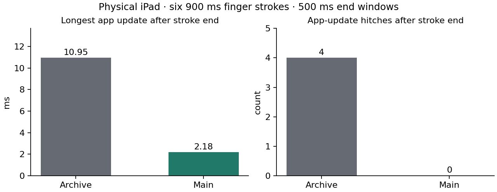
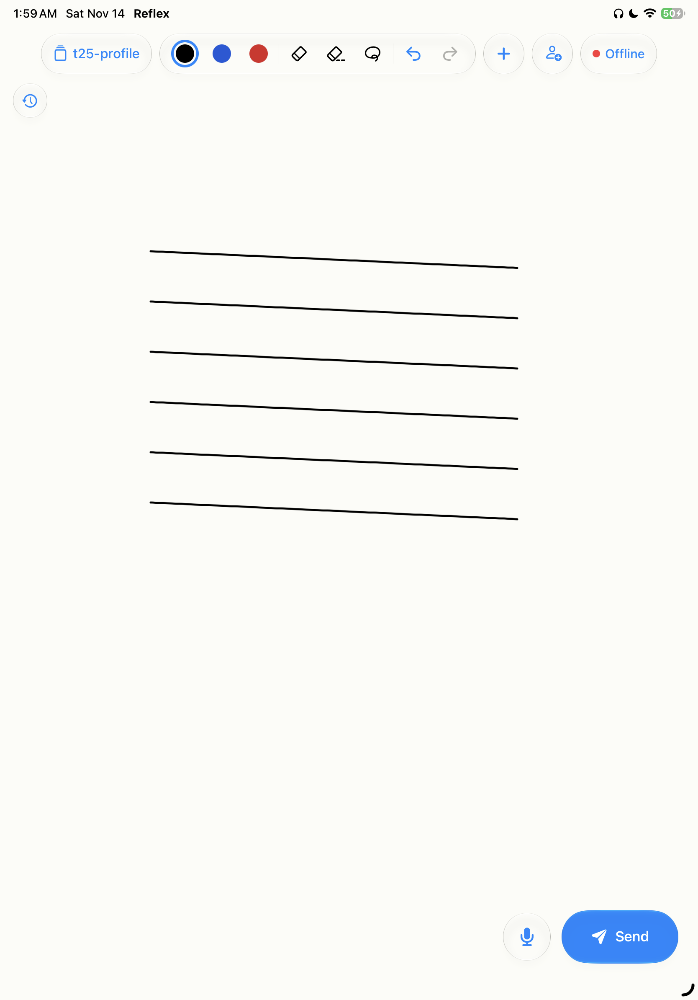
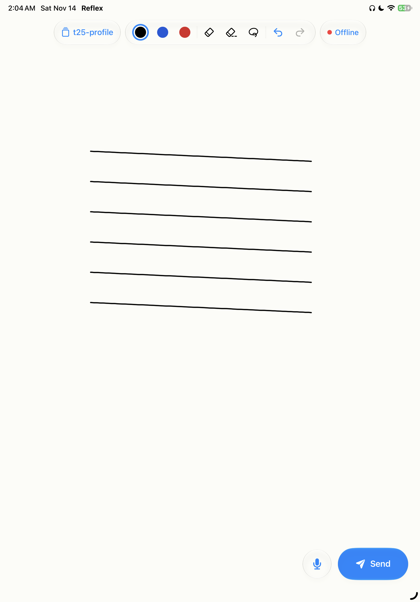

# Physical iPad ink profile — 14 November 2026

The native change reduced stroke-end app work in this run. Drawing cadence was essentially unchanged. This is a finger-input profile on the person's physical **iPad13,6 (11-inch iPad Pro, M1), iPadOS 27.2 / 24B119**, connected by USB to Xcode 26.4.1 (17E202). It is not an input-to-photon or Apple Pencil latency measurement.

## Results



One valid six-stroke capture per build, same blank `t25-profile` page, black pen, portrait, initial zoom/offset. Values pool the six strokes; p95 uses nearest rank. The first partial display callback after each tool-down is excluded. End windows include the first callback after tool-up and continue for 500 ms.

| Measurement | Before: archive/canvas-v0 | After: main |
|---|---:|---:|
| Drawing main-thread callback intervals | 635 | 637 |
| Drawing median callback gap | 8.3314 ms | 8.3345 ms |
| Drawing p95 callback gap | 9.1340 ms | 8.9116 ms |
| Drawing maximum callback gap | 17.0489 ms | 17.5863 ms |
| Drawing gaps over 33.33 ms | 0 | 0 |
| Instruments hitches overlapping drawing | 1 (12.5052 ms, app update) | 1 (8.3369 ms, app update) |
| End-window callback intervals | 323 | 349 |
| End-window p95 callback gap | 18.4039 ms | 16.0497 ms |
| End-window maximum callback gap | 40.0927 ms | 24.9998 ms |
| End-window gaps over 33.33 ms | 1 | 0 |
| End-window Instruments expensive **app-update** hitches | 4 | 0 |
| End-window Instruments hitches, all causes | 5 / 50.0203 ms total | 1 / 8.3367 ms total |
| Longest Instruments app-update interval overlapping an end window | 10.9522 ms | 2.1807 ms |

The remaining after hitch was labeled **“Potentially expensive render, 23 offscreen passes)”**, not an app-update hitch. Before had four “Potentially expensive app update(s)” events and one unlabeled event after stroke end. A hitch's duration is Instruments' missed presentation time, not the duration of the entire app update.

Main-thread callback gaps include scheduling and adaptive display cadence; they are **not** literal rendered frame durations or proof that the main thread was blocked for that entire gap. Instruments' app-update intervals and hitch classifications provide the separate evidence for stroke-end main-thread work. Time Profiler also sampled the old `SpaceSession.commit(_:)` path in 57 main-thread samples inside the six end windows, including Rust/Automerge frames. The new build had no such path; `InkCanvasController.drawingChanged()` appeared in 5 samples versus 59 before. These are supporting sampled-stack counts, not precise CPU timings.

| Stroke | Before: largest end callback gap | After | Before: largest app update in end window | After |
|---|---:|---:|---:|---:|
| 1 | 40.0927 ms | 24.9761 ms | 10.9522 ms | 2.1807 ms |
| 2 | 32.5818 ms | 20.2924 ms | 8.6878 ms | 0.0693 ms |
| 3 | 32.4750 ms | 24.9959 ms | 8.0250 ms | 0.0605 ms |
| 4 | 29.0627 ms | 16.8870 ms | 10.7350 ms | 0.0363 ms |
| 5 | 25.0853 ms | 24.9998 ms | 3.3452 ms | 0.0576 ms |
| 6 | 23.8505 ms | 9.5679 ms | 1.1090 ms | 0.0744 ms |

This small straight-line run does not establish a general latency percentage or performance on dense pages, rapid handwriting, a live paired Link, or Pencil input. Both valid captures used the existing pairing with the Link unreachable; no network settings were changed and no Send was pressed. It measures the old local commit path even without a reachable server.

## Builds and repeatable method

- Before source: `archive/canvas-v0`, `b6ec634c74d8ea7576c0003903aed61d8b6352a9`.
- After source: current main at start, `b50db8e19f5285995163f665efe7eb03e69fbafc`.
- Both: Release optimization, generic iOS arm64 build, same development team/bundle (`si.eilmer.reflex`), same attached device. No TestFlight archive/upload. The old generated kernel framework/bindings were reused from a local build whose entire `kernel/` source is identical to the archive (`git diff --exit-code` verified).
- Only profiling changes: add [InkProfileProbe.swift](physical/InkProfileProbe.swift) to `ReflexInput`; call `InkProfileProbe.shared.begin()` at entry to `canvasViewDidBeginUsingTool`, and `.end()` at entry to `canvasViewDidEndUsingTool`; set the physical canvas's drawing policy to `.anyInput` in both builds to enable finger automation. No global Pencil setting was changed. The probe runs a default-cadence `CADisplayLink` in the main run loop's common mode and emits public `os_signpost` events for tool-down/up and callback gaps. It does not set a preferred frame rate.
- Seed a dedicated page from the person's existing empty page (zero strokes), retaining its archived blank document/native drawing. Restore those same three blank files before the after run. Original pages are not used for strokes.
- Open the app and choose `t25-profile` with agent-device. Same six commands in each capture:

```sh
for y in 300 360 420 480 540 600; do
  AGENT_DEVICE_IOS_TEAM_ID=AX3C2B78YD \
  AGENT_DEVICE_IOS_BUNDLE_ID=si.eilmer.reflex.agentdevice \
  ~/.local/bin/agent-device gesture pan 180 "$y" 440 20 900 \
    --device iPad --session t25
done
```

- Run one 40-second capture with `xcrun xctrace record --template 'Animation Hitches' --instrument 'Time Profiler' --instrument os_signpost --device <physical-UDID> --attach Reflex --time-limit 40s --output <trace> --no-prompt`. Start gestures after recording reports that it attached. Keep capture running at least 500 ms after the last tool-up.
- Export each `os-signpost`, `hitches` and `hitches-updates` table using `xctrace export --xpath '/trace-toc/run[@number="1"]/data/table[@schema="..."]'`. The committed [extractor](physical/extract.py) resolves Instruments XML references and correlates timestamps. Put exports at `/tmp/t25-{before,after}-{signposts,hitches,updates}.xml` and run `python3 extract.py before` / `after`. It writes CSV/JSON under `/tmp`. Colored app-update rows may duplicate intervals: report maxima, not their sum.

Raw, unrounded extracted values: [before summary](physical/t25-before-summary.json), [after summary](physical/t25-after-summary.json), [before callbacks](physical/t25-before-frames.csv), [after callbacks](physical/t25-after-frames.csv), [before hitch events](physical/t25-before-hitches.csv), [after hitch events](physical/t25-after-hitches.csv). Full Instruments traces remain on the profiling Mac at `/tmp/t25-before.trace` (239 MB) and `/tmp/t25-after-restored.trace` (226 MB); they are not committed because they contain device/process metadata and are large. Time Profiler XML remains alongside them as `/tmp/t25-{before,after}-cpu.xml`.

## Data preservation and cleanup

The installed app initially reported build `202611140124`. A complete 46 MB app-container backup was taken **before** any development install, at `/tmp/t25-person-data-backup` on the profiling Mac; it contains private data and is not committed. The development signature uses the same application identifier/team and installs in place, without uninstall. After the archived build's install, all 13 original page files were verified present and byte-identical.

A subsequent `devicectl copy to --remove-existing-content true` reset unexpectedly removed more than the requested profiling page, including original pages/pairing state. That intermediate after trace (`/tmp/t25-after.trace`) was discarded. All **26 original Reflex application-support files** were restored from the backup and verified byte-for-byte, with none missing or changed, before taking the valid after capture. The profiling page was separately verified to match the original blank drawing. Never use that reset option for this procedure again; copy the three profiling files individually without removal.

Cleanup status: the device locked/lost its CoreDevice power/trust assertion after measurement (error 4016). A clean, uninstrumented Release build of main is built and development-signed, ready to install when access returns. The pending install has not succeeded; the main **profiling** build remains on the iPad. No deletion/uninstall is needed. Final cleanup/data recheck will be recorded here after unlock.

## Pencil check for the person

On the clean current build, open a page and use the real Pencil: write a quick sentence with small loops and dots, draw fast zigzags, then several short strokes with abrupt lifts. Look for ink trailing the tip or a pause immediately after each lift. Try the eraser and undo; leave and reopen the page to check local persistence. Finally press Send and confirm that the agent receives the marks and screen crop. Report which action lagged and whether the pause happened while drawing or just after lifting. This remains a human check; finger automation cannot validate Pencil prediction or tip-to-ink latency.




