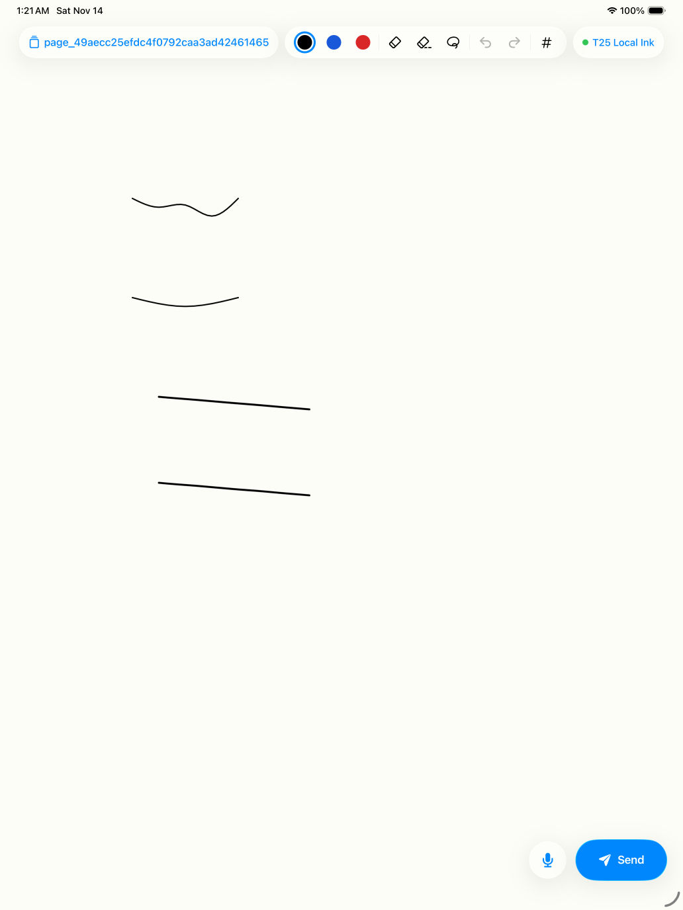

T25 verification, 2026-11-14

Used the real simulator app (si.eilmer.reflex), native PencilKit canvas, paired encrypted LAN connection and isolated Link profile /tmp/reflex-t25-live. Physical iPad is held by research: no takeover, no latency numbers claimed, no physical install or TestFlight build/upload.

Built: xcodebuild -project apps/ipad/Reflex.xcodeproj -scheme Reflex -destination 'generic/platform=iOS Simulator' -derivedDataPath /tmp/reflex-t25-build CODE_SIGNING_ALLOWED=NO build => BUILD SUCCEEDED.
Types: npm run typecheck => root, agent, relay clean. No lint script.
Fast checks: node --test link/test/reapprove.test.ts link/test/self-approve.test.ts link/test/terminal-queue.test.ts link/test/stop.test.ts => 7 passed.
Reviewer regression: node --test review-tests/offline-order.test.ts => failed before S1 fix; passed afterward. Executes production Swift replay methods with persisted original/correction envelopes, reversed lexical UUID order.

Live use:
- Paired through Pair UI; Allow Codex T25 verification through iPad approval dialog after relaunch.
- Drew a native stroke, Link native_sends count before Send = 0.
- Tapped Send: CLI got s_93c7e56fa2214e93851bde3c8cbb3c82, one mark/stroke and PNG. Visually inspected crop: drawn line is present.
- Stopped isolated Link, relaunched app: native page ink persisted. Drew and tapped Send offline. Restarted Link: second Send s_7ba112083b6c4a9ba697d856babb8f9c ingested, outbox empty after ack. First unacknowledged Send returned redelivered:true. No duplicate native_sends rows.
- Native finger swipe via simulator UI created 12-point stroke. Tapped Send: Claude channel adapter received s_b8bfdf47f432418cbfa5c8dc38a4832b with 1 mark and 10,695-byte PNG through Client.listen (protocol receiver, not a running Claude Code harness).
- Another native finger swipe and Send reached local webhook receiver s_5c3444bf5970419390a62096691f6ab8, signed HMAC verified, PNG included.
- Real stdio MCP server initialized from SDK client identifying as Codex: listTools only wait_for_user; call acknowledged first Send and returned next durable Send with text and 14,628-byte image content blocks.
- Live lifecycle issue: discarded SwiftUI @State initializer instances started networking, competing for one paired session. Logs showed Connected every 0.3–1 sec and Offline UI while Sends worked via retained old instance. Moved networking to idempotent start() in installed .task. Rebuilt/installed, relaunched and opened same debug URL: UI stays connected, new process logs one connection.

Check changes: asset synchronization tests removed because Link-to-Link asset replication is removed by this ticket. Self-approval subprocess fixture dropped removed --no-web argument. No approval checks weakened. Rust/kernel tests disappear with removed kernel.

Pending: before/after xctrace profile on iPad13,6 iPadOS27.2 and person's final Pencil check. Parent explicitly permits MR before exclusive device turn. Voice implementation is retained; microphone transcription wasn't exercised in this simulator session.

Sol ledger: two rounds, GPT-6.1 Sol (codex provider), medium reasoning. S1 (should) offline replay ordering fixed, reviewer regression retained. Round 2 APPROVE, no open or declined findings. Additional own lifecycle fix reviewed and live-proved. Diff before review: 103 files, +557/-20115. After behavior fixes: 104 files, +636/-20122. Usage not returned by review delegates.

